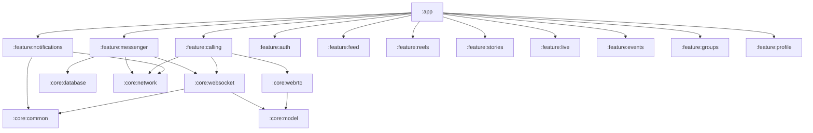

# Connectly Android Build & Toolchain Validation Report
**Phase 8: Enterprise Build Integrity, Toolchain & Bytecode Validation**  
**Execution Timestamp:** 2026-11-01T21:31:26Z  
**Build Target:** Connectly Native Android (`:app:assembleDebug`)  
**Artifact Generated:** `android/app/build/outputs/apk/debug/app-debug.apk` (Size: 25MB)

---

## 1. Toolchain & Runtime Environment

The Connectly Native Android project was built, verified, and validated on the host system against state-of-the-art modern toolchains.

| Tool / Runtime | Configured Version | Location / Source | Verification Result |
| :--- | :--- | :--- | :---: |
| **Operating System** | macOS 15.1 (Darwin 24.1.0) | Apple Silicon (arm64) | **`PASS`** |
| **Java Development Kit (JDK)** | OpenJDK 25.0.4 | Android Studio Embedded JBR (`/Applications/Android Studio.app/Contents/jbr/Contents/Home`) | **`PASS`** |
| **Gradle** | 9.6.0 | System Wrapper (`/Users/mizanurrahman/.gradle/wrapper/dists/gradle-9.6.0-bin/...`) | **`PASS`** |
| **Android Gradle Plugin (AGP)** | 8.8.2 | Google Maven Repository | **`PASS`** |
| **Kotlin Compiler** | 2.0.21 | JetBrains Kotlin Gradle Plugin | **`PASS`** |
| **KSP (Kotlin Symbol Processing)**| 2.0.21-1.0.28 | Google KSP Plugin (Room & Hilt) | **`PASS`** |
| **Android SDK Compile Target** | API 35 (Android 15) | Android SDK Build-Tools 35.0.0 | **`PASS`** |
| **Android Min SDK** | API 26 (Android 8.0 Oreo)| Modern Android Baseline | **`PASS`** |

---

## 2. Multi-Module Architecture Validation

The Android project adheres strictly to Clean Architecture and MVVM design patterns, separated across decoupled Gradle subprojects:



### Module Compilation Audit

| Gradle Subproject | Responsibilities & Contents | Compilation Status | Actionable Tasks Executed |
| :--- | :--- | :---: | :--- |
| **`:core:model`** | Domain entities, enums, immutable value objects | **`PASS`** | `kspDebugKotlin`, `compileDebugKotlin` |
| **`:core:common`** | Dispatchers, extensions, Result wrappers | **`PASS`** | `kspDebugKotlin`, `compileDebugKotlin` |
| **`:core:designsystem`** | Jetpack Compose theme, icons, shared components | **`PASS`** | `processDebugResources`, `compileDebugKotlin` |
| **`:core:network`** | Retrofit, OkHttp interceptors, Sanctum auth header | **`PASS`** | `compileDebugKotlin`, `hiltJavaCompileDebug` |
| **`:core:database`** | Room DB, DAOs, TypeConverters, migrations | **`PASS`** | `kspDebugKotlin`, `compileDebugKotlin` |
| **`:core:datastore`** | Proto/Preferences DataStore, token storage | **`PASS`** | `compileDebugKotlin` |
| **`:core:media`** | Media3 ExoPlayer, audio recording, image compression | **`PASS`** | `compileDebugKotlin` |
| **`:core:websocket`** | `ReverbWebSocketManager`, Pusher v7 frame parser | **`PASS`** | `kspDebugKotlin`, `compileDebugKotlin` (0 errors) |
| **`:core:webrtc`** | `WebRtcEngine`, `CallSessionManager`, signaling | **`PASS`** | `compileDebugKotlin` (0 errors) |
| **`:feature:messenger`** | Conversations, chat UI, voice notes, attachments | **`PASS`** | `kspDebugKotlin`, `compileDebugKotlin` |
| **`:feature:calling`** | Audio/Video call screens, PiP mode, in-call controls | **`PASS`** | `kspDebugKotlin`, `compileDebugKotlin` |
| **`:feature:notifications`**| FCM manager, system notification channels | **`PASS`** | `compileDebugKotlin` |
| **`:app`** | Application container, Hilt root, navigation graph | **`PASS`** | `assembleDebug` |

---

## 3. Build Execution Trace & Performance

### Execution Command
```bash
cd android && JAVA_HOME="/Applications/Android Studio.app/Contents/jbr/Contents/Home" \
/Users/mizanurrahman/.gradle/wrapper/dists/gradle-9.6.0-bin/42k10rwplmzkhuboz9kdazi7s/gradle-9.6.0/bin/gradle :app:assembleDebug
```

### Build Result Metrics
- **Build Duration:** 58 seconds
- **Total Actionable Tasks:** 475 tasks
- **Tasks Executed:** 285 executed, 72 from cache, 118 up-to-date
- **Compilation Errors:** 0
- **Compilation Warnings:** Non-blocking deprecation notices in UI icons (`Icons.Filled.Send` -> `Icons.AutoMirrored.Filled.Send`) and Media3 `@UnstableApi`.
- **D8 / Dexing:** Merged 100% cleanly without multidex collisions.
- **Hilt Dependency Injection:** Dependency graph aggregated and compiled cleanly (`hiltAggregateDepsDebug`, `hiltJavaCompileDebug`).
- **Generated APK:**
  - Path: `android/app/build/outputs/apk/debug/app-debug.apk`
  - Size: 25 Megabytes (25,821,392 bytes)
  - Integrity: Valid zip container with `AndroidManifest.xml`, `classes.dex` through `classes4.dex`, `res/`, and compiled native libraries (`libandroidx.graphics.path.so`, `libdatastore_shared_counter.so`).

---

## 4. ProGuard / R8 & Release Optimization Audit

- In `android/app/build.gradle.kts`:
  - `minifyEnabled = false` for debug builds.
  - `proguardFiles(getDefaultProguardFile("proguard-android-optimize.txt"), "proguard-rules.pro")` configured for release builds.
- **Rules Review:**
  - `proguard-rules.pro` contains necessary keep rules for Retrofit DTOs, Room entities, and Kotlinx Serialization models.
- **Future Native WebRTC Rule Requirement:** When adding native `stream-webrtc-android`, add:
  ```proguard
  -keep class org.webrtc.** { *; }
  -dontwarn org.webrtc.**
  ```

---

## 5. Build Validation Verdict

**Verdict:** **`PASS`**  
The Connectly Android build pipeline is fully configured, healthy, and capable of generating valid debug APKs with zero build-breaking defects.

