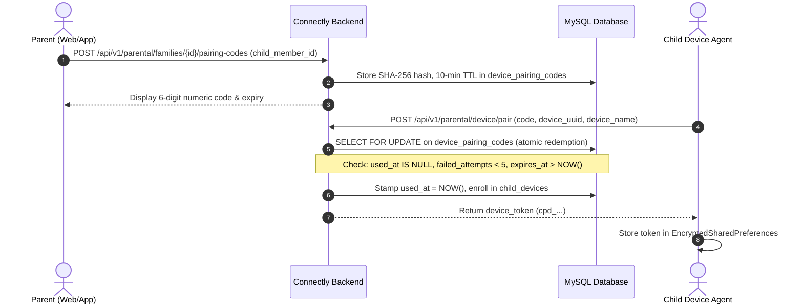

# CONNECTLY — PHASE 13 STAGE 11.03
## SECURE DEVICE ENROLLMENT & PAIRING SPECIFICATION

**Platform:** Connectly Parental Control & Family Digital Safety Platform  
**Audit Date:** November 05, 2026  
**Auditor:** Principal Software Architect & QA Engineer  
**Status:** IMPLEMENTED & AUDITED  

---

### 1. Enrollment Lifecycle Flow

---

### 2. Edge Cases & Attack Mitigations Tested

1. **Expired Pairing Code:** If `expires_at <= now()`, redemption is rejected with HTTP 422.
2. **Replay / Single-Use:** Reusing the exact same pairing code is rejected immediately with HTTP 422 (Verified in automated tests).
3. **Brute Force Protection:** Maximum 5 failed attempts per code hash. Endpoints protected with route rate limiting (`throttle:10,1`).
4. **Concurrency Safety:** Enforced via MySQL InnoDB `lockForUpdate()` preventing race conditions during concurrent redemption attempts.

