# CONNECTLY — PHASE 02: SYSTEM ARCHITECTURE & DATABASE DESIGN SPECIFICATION
## Enterprise-Grade Modular Backend Architecture for Web & Mobile

**Project:** Connectly (JUGAJUG Social Network)  
**Backend Framework:** Laravel 13.32.0 (PHP 8.5.6)  
**Architecture Pattern:** API-First Modular Clean Architecture (Web, Android, iOS unified backend)  
**Database Engine:** Relational RDBMS (MySQL 8.0+ / SQLite 3.38+ with foreign key enforcement)  
**Broadcasting & WebSocket:** Laravel Reverb + Pusher Protocol  
**Queue & Async Workers:** Laravel Horizon + Redis (Predis 3.6)  
**Media Engine:** Chunked Resumable Uploads + Flysystem S3 / Local Storage  

---

## ১. ভূমিকা ও আর্কিটেকচারাল দৃষ্টিভঙ্গি (Architectural Overview)

Connectly-এর ব্যাকএন্ড একটি **API-First, Multi-Tenant Social Graph Architecture** অনুসরণ করে নির্মিত। একই কোর ব্যাকএন্ড ও ডাটাবেস সার্ভিস ব্যবহার করে:
1. **Connectly Android Client** (Kotlin + Jetpack Compose)
2. **Connectly Web Client** (Vue 3 + Inertia.js + Tailwind v4)
3. **Connectly iOS Client** (Future Swift/SwiftUI Integration)
4. **Enterprise Admin Dashboard** (Laravel Blade + Alpine/Tailwind)

### আর্কিটেকচারাল লেয়ারসমূহ (Layered Separation of Concerns):
```
┌────────────────────────────────────────────────────────────────────────┐
│                   CLIENT APPS (Android / Web / iOS)                    │
└───────────────────────────────────┬────────────────────────────────────┘
                                    │ HTTP / REST / WebSockets
                                    ▼
┌────────────────────────────────────────────────────────────────────────┐
│                 ROUTING & MIDDLEWARE BOUNDARY                          │
│  (Sanctum Stateful / Bearer, RateLimiting, SessionTimeout, Roles)      │
└───────────────────────────────────┬────────────────────────────────────┘
                                    │
                                    ▼
┌────────────────────────────────────────────────────────────────────────┐
│                CONTROLLERS & API RESOURCES (V1 / V2)                   │
│   (Request Validation via FormRequests, Consistent JSON Envelopes)     │
└───────────────────────────────────┬────────────────────────────────────┘
                                    │
                                    ▼
┌────────────────────────────────────────────────────────────────────────┐
│                        SERVICE & DOMAIN LAYER                          │
│  (AuthService, PostService, StoryService, MessengerService, Profile)   │
└───────────────────────────────────┬────────────────────────────────────┘
                                    │
                                    ▼
┌────────────────────────────────────────────────────────────────────────┐
│                     DATABASE ELOQUENT REPOSITORY                       │
│  (140+ Models, Polymorphic Relations, SoftDeletes, Scopes, Indexes)   │
└───────────────────────────────────┬────────────────────────────────────┘
                                    │
                                    ▼
┌────────────────────────────────────────────────────────────────────────┐
│                  RDBMS STORAGE (101 Tables & Migrations)                │
└────────────────────────────────────────────────────────────────────────┘
```

---

## ২. ডাটাবেস এনটিটি-রিলেশনশিপ ডায়াগ্রাম (Database ERD)

```mermaid
erDiagram
    USERS ||--o{ USER_PROFILES : "has one"
    USERS ||--o{ USER_SETTINGS : "has one"
    USERS ||--o{ PRIVACY_SETTINGS : "has one"
    USERS ||--o{ NOTIFICATION_SETTINGS : "has one"
    USERS ||--o{ USER_SESSIONS : "has many"
    USERS ||--o{ TRUSTED_DEVICES : "has many"
    USERS ||--o{ FRIENDSHIPS : "initiates"
    USERS ||--o{ USER_FOLLOWERS : "follows/followed"
    USERS ||--o{ POSTS : "authors"
    USERS ||--o{ COMMENTS : "writes"
    USERS ||--o{ REACTIONS : "reacts"
    USERS ||--o{ STORIES : "publishes"
    USERS ||--o{ REELS : "publishes"
    USERS ||--o{ CONVERSATION_PARTICIPANTS : "participates"
    USERS ||--o{ MESSAGES : "sends"
    USERS ||--o{ GROUP_MEMBERS : "joins"
    USERS ||--o{ PAGE_MEMBERS : "manages"

    POSTS ||--o{ COMMENTS : "has many"
    POSTS ||--o{ REACTIONS : "has polymorphic"
    POSTS ||--o{ POST_SHARES : "shared via"
    POSTS ||--o{ MEDIA : "contains"
    POSTS ||--o{ SAVED_ITEMS : "bookmarked"

    STORIES ||--o{ STORY_MEDIA : "contains slides"
    STORIES ||--o{ STORY_VIEWS : "tracked views"
    STORIES ||--o{ STORY_REACTIONS : "reactions"
    STORIES ||--o{ STORY_REPLIES : "direct replies"

    CONVERSATIONS ||--o{ CONVERSATION_PARTICIPANTS : "members"
    CONVERSATIONS ||--o{ MESSAGES : "message history"
    MESSAGES ||--o{ MESSAGE_REACTIONS : "reactions"
    CONVERSATIONS ||--o{ CALLS : "voice/video calls"

    GROUPS ||--o{ GROUP_MEMBERS : "roster"
    GROUPS ||--o{ POSTS : "group feed"
    GROUPS ||--o{ GROUP_RULES : "moderation rules"

    PAGES ||--o{ PAGE_MEMBERS : "admins & editors"
    PAGES ||--o{ PAGE_FOLLOWERS : "subscribers"
    PAGES ||--o{ POSTS : "page feed"
```



---

## ৩. ১১টি কোর ডাটাবেস মডিউলের বিস্তারিত স্কিমা স্পেসিফিকেশন

### মডিউল ১: ইউজার ও সিকিউরিটি (Users & Security)
1. **`users`**:
   - `id` (BIGINT UNSIGNED PK)
   - `name` (VARCHAR 100), `username` (VARCHAR 50 UNIQUE INDEX), `email` (VARCHAR 191 UNIQUE INDEX), `phone` (VARCHAR 25 UNIQUE INDEX NULLABLE)
   - `password` (VARCHAR 255 - Argon2id / Bcrypt)
   - `status` (ENUM: 'active', 'inactive', 'suspended', 'banned', 'deactivated')
   - `is_verified` (BOOLEAN DEFAULT false), `verified_at` (TIMESTAMP NULLABLE)
   - `two_factor_enabled` (BOOLEAN DEFAULT false), `two_factor_secret` (TEXT NULLABLE - encrypted), `two_factor_recovery_codes` (TEXT NULLABLE - encrypted)
   - `two_factor_confirmed_at` (TIMESTAMP NULLABLE), `two_factor_type` (ENUM: 'totp', 'email', 'sms')
   - `created_at`, `updated_at`, `deleted_at` (SOFT DELETES)
2. **`user_profiles`**:
   - `id` (BIGINT PK), `user_id` (FK -> users.id CASCADE)
   - `avatar_url` (VARCHAR 2048), `cover_url` (VARCHAR 2048)
   - `bio` (VARCHAR 500), `about` (TEXT), `gender` (ENUM: 'male', 'female', 'other', 'prefer_not_to_say')
   - `birth_date` (DATE), `city` (VARCHAR 100), `hometown` (VARCHAR 100), `website` (VARCHAR 255)
   - `relationship_status` (VARCHAR 50), `is_avatar_guarded` (BOOLEAN DEFAULT false)
3. **`user_settings`**:
   - `id` (BIGINT PK), `user_id` (FK -> users.id CASCADE)
   - `who_can_see_posts` (ENUM: 'public', 'friends', 'only_me' DEFAULT 'public')
   - `who_can_send_friend_requests` (ENUM: 'everyone', 'friends_of_friends')
   - `who_can_message` (ENUM: 'everyone', 'friends', 'no_one')
   - `is_profile_locked` (BOOLEAN DEFAULT false), `has_avatar_guard` (BOOLEAN DEFAULT false)
   - `dark_mode` (BOOLEAN DEFAULT false), `language` (VARCHAR 10 DEFAULT 'bn')
4. **`privacy_settings`**:
   - `id` (BIGINT PK), `user_id` (FK -> users.id CASCADE)
   - `show_online_status` (BOOLEAN DEFAULT true), `search_engine_indexing` (BOOLEAN DEFAULT true)
5. **`trusted_devices` & `user_sessions`**:
   - `user_id` (FK), `device_fingerprint` (VARCHAR 191 INDEX), `device_name` (VARCHAR 100)
   - `ip_address` (VARCHAR 45), `token_id` (BIGINT NULLABLE), `last_active_at` (TIMESTAMP)

---

### মডিউল ২: সোশ্যাল গ্রাফ (Social Connections & Relationships)
1. **`friendships`**:
   - `id` (BIGINT PK)
   - `user_id` (FK -> users.id CASCADE)
   - `friend_id` (FK -> users.id CASCADE)
   - `status` (ENUM: 'pending', 'accepted', 'rejected', 'blocked')
   - `is_restricted` (BOOLEAN DEFAULT false), `is_muted` (BOOLEAN DEFAULT false)
   - UNIQUE INDEX (`user_id`, `friend_id`)
2. **`user_followers`**:
   - `id` (BIGINT PK), `user_id` (FK -> users.id), `follower_id` (FK -> users.id)
   - UNIQUE INDEX (`user_id`, `follower_id`)
3. **`blocked_users`**:
   - `id` (BIGINT PK), `user_id` (FK), `blocked_user_id` (FK), `reason` (VARCHAR 255)

---

### মডিউল ৩: পোস্ট ও ইন্টারঅ্যাকশন (Posts, Comments, Reactions)
1. **`posts`**:
   - `id` (BIGINT PK), `user_id` (FK -> users.id CASCADE)
   - `group_id` (FK -> groups.id NULLABLE), `page_id` (FK -> pages.id NULLABLE)
   - `caption` (TEXT), `privacy` (ENUM: 'public', 'friends', 'only_me', 'custom')
   - `post_type` (ENUM: 'text', 'photo', 'video', 'link', 'poll', 'reel', 'feeling')
   - `location` (VARCHAR 255), `feeling` (VARCHAR 50)
   - `likes_count`, `comments_count`, `shares_count`, `views_count` (BIGINT DEFAULT 0)
   - `is_pinned` (BOOLEAN DEFAULT false), `comments_disabled` (BOOLEAN DEFAULT false)
   - `created_at`, `updated_at`, `deleted_at` (SOFT DELETES)
2. **`comments`**:
   - `id` (BIGINT PK), `user_id` (FK), `post_id` (FK), `parent_id` (FK -> comments.id NULLABLE - Nested Replies)
   - `comment_text` (TEXT), `media_url` (VARCHAR 2048 NULLABLE), `likes_count` (INT DEFAULT 0)
3. **`reactions` (Polymorphic)**:
   - `id` (BIGINT PK), `user_id` (FK)
   - `reactable_type` (VARCHAR 100), `reactable_id` (BIGINT)
   - `type` (ENUM: 'like', 'love', 'care', 'haha', 'wow', 'sad', 'angry')
   - UNIQUE INDEX (`user_id`, `reactable_type`, `reactable_id`)
4. **`saved_items` (Polymorphic)**:
   - `user_id` (FK), `saveable_type` (VARCHAR 100), `saveable_id` (BIGINT), `collection_name` (VARCHAR 100)

---

### মডিউল ৪: স্টোরিজ সিস্টেম (24-Hour Stories Engine)
1. **`stories`**:
   - `id` (BIGINT PK), `user_id` (FK), `page_id` (FK NULLABLE)
   - `caption` (VARCHAR 500), `background_color` (VARCHAR 30)
   - `privacy` (ENUM: 'public', 'friends', 'custom')
   - `expires_at` (TIMESTAMP INDEX), `is_archived` (BOOLEAN DEFAULT false)
2. **`story_media`**:
   - `story_id` (FK), `media_type` (ENUM: 'image', 'video'), `media_url` (VARCHAR 2048), `duration` (FLOAT)
3. **`story_views`**:
   - `story_id` (FK), `user_id` (FK), `viewed_at` (TIMESTAMP)
4. **`story_highlights` & `story_highlight_items`**:
   - পার্মানেন্ট স্টোরি কালেকশন প্রোফাইল শোকেসিং এর জন্য।

---

### মডিউল ৫: মেসেজিং ও আরটিসি (Real-Time Messenger & WebRTC Calls)
1. **`conversations`**:
   - `id` (BIGINT PK), `type` (ENUM: 'direct', 'group'), `title` (VARCHAR 100 NULLABLE), `avatar` (VARCHAR 2048)
2. **`conversation_participants`**:
   - `conversation_id` (FK), `user_id` (FK), `role` (ENUM: 'member', 'admin'), `last_read_message_id` (BIGINT NULLABLE)
3. **`messages`**:
   - `id` (BIGINT PK), `conversation_id` (FK), `user_id` (FK)
   - `message` (TEXT NULLABLE), `type` (ENUM: 'text', 'image', 'video', 'audio', 'document', 'call_log')
   - `attachment_url` (VARCHAR 2048 NULLABLE), `is_read` (BOOLEAN DEFAULT false)
   - `created_at`, `deleted_at`
4. **`calls` & `call_participants`**:
   - `call_uuid` (UUID UNIQUE), `caller_id` (FK), `conversation_id` (FK)
   - `call_type` (ENUM: 'voice', 'video'), `status` (ENUM: 'ringing', 'answered', 'rejected', 'missed', 'ended')
   - `started_at`, `ended_at`, `duration_seconds` (INT)

---

### মডিউল ৬: গ্রুপস ও কমিউনিটি (Groups & Communities)
1. **`groups`**:
   - `id` (BIGINT PK), `creator_id` (FK -> users.id), `name` (VARCHAR 100), `slug` (VARCHAR 120 UNIQUE)
   - `privacy` (ENUM: 'public', 'private', 'hidden'), `cover_url` (VARCHAR 2048), `description` (TEXT)
   - `members_count` (INT DEFAULT 1), `posts_count` (INT DEFAULT 0)
2. **`group_members`**:
   - `group_id` (FK), `user_id` (FK), `role` (ENUM: 'owner', 'admin', 'moderator', 'member')
   - `status` (ENUM: 'active', 'pending', 'banned')

---

### মডিউল ৭: বিজনেস পেজ (Pages & Organizations)
1. **`pages`**:
   - `id` (BIGINT PK), `owner_id` (FK -> users.id), `name` (VARCHAR 100), `username` (VARCHAR 50 UNIQUE)
   - `category` (VARCHAR 100), `website` (VARCHAR 255), `avatar_url` (VARCHAR 2048), `cover_url` (VARCHAR 2048)
   - `followers_count` (INT DEFAULT 0), `is_verified` (BOOLEAN DEFAULT false)
2. **`page_members`**:
   - `page_id` (FK), `user_id` (FK), `role` (ENUM: 'owner', 'admin', 'editor', 'moderator', 'analyst')

---

### মডিউল ৮: রিলস ও ভিডিও (Reels & Short Video Platform)
1. **`reels`**:
   - `id` (BIGINT PK), `user_id` (FK -> users.id)
   - `caption` (TEXT), `video_url` (VARCHAR 2048), `thumbnail_url` (VARCHAR 2048)
   - `music_track_id` (FK -> music_tracks.id NULLABLE), `duration` (FLOAT)
   - `views_count`, `likes_count`, `comments_count`, `shares_count` (BIGINT DEFAULT 0)
2. **`reel_comments` & `reel_reactions`**:
   - শর্ট ভিডিও রিঅ্যাকশন এবং ইন্টারঅ্যাকশন।

---

### মডিউল ৯: নোটিফিকেশনস ও অ্যালার্টস (Notifications Engine)
1. **`notifications` (Laravel Standard Polymorphic)**:
   - `id` (UUID PK), `type` (VARCHAR 255), `notifiable_type`, `notifiable_id` (INDEX)
   - `data` (JSON - actor, action, target_id, target_url, message, title)
   - `read_at` (TIMESTAMP NULLABLE), `created_at` (INDEX)
2. **`notification_settings`**:
   - ইমেইল, পুশ ও ইন-অ্যাপ চ্যানেলের জন্য ক্যাটাগরি ফিল্টার।

---

### মডিউল ১০: মিডিয়া ও রেজুমেবল আপলোড (Media & Chunking System)
1. **`media` (Polymorphic Attachments)**:
   - `id` (BIGINT PK), `mediable_type`, `mediable_id`
   - `file_path`, `disk` ('public', 's3'), `mime_type`, `size_bytes`, `metadata` (JSON: width, height, bitrate)
2. **`media_upload_sessions` & `media_upload_chunks`**:
   - বড় ভিডিও/অডিও ফাইলের জন্য মেমরি-সেফ চাঙ্কড আপলোড ও রিট্রাই মেকানিজম।

---

### মডিউল ১১: অ্যাডমিনিস্ট্রেশন ও গভর্ন্যান্স (Administration & Audit)
1. **`roles` & `permissions`** (RBAC):
   - `role_user`, `permission_role`
2. **`reports` (Polymorphic Moderation)**:
   - `reporter_id` (FK), `reportable_type`, `reportable_id`, `reason`, `status` ('pending', 'resolved', 'dismissed')
3. **`audit_logs`**:
   - `user_id`, `action`, `ip_address`, `user_agent`, `payload` (JSON)

---

## ৪. ইউনিফাইড এপিআই রেসপন্স এনভেলপ ও সংস্করণ কাঠামো

মোবাইল এবং ওয়েব ক্লায়েন্টের জন্য এপিআই-তে একটি মানসম্মত JSON কাঠামো প্রয়োগ করা হয়েছে:

### সফল রেসপন্স স্ট্রাকচার (Success Envelope):
```json
{
  "success": true,
  "status": "success",
  "data": { ... },
  "message": "অপারেশনটি সফলভাবে সম্পন্ন হয়েছে।",
  "meta": {
    "current_page": 1,
    "last_page": 10,
    "per_page": 20,
    "total": 195
  }
}
```

### এরর রেসপন্স স্ট্রাকচার (Error Envelope):
```json
{
  "success": false,
  "status": "error",
  "message": "অনুরোধটি সম্পন্ন করা যায়নি।",
  "errors": {
    "email": ["প্রদত্ত ইমেইলটি ইতিপূর্বে ব্যবহৃত হয়েছে।"]
  },
  "code": 422
}
```

---

## ৫. এপিআই সংস্করণ ম্যাপিং (API Versioning Mapping)

| রিসোর্স / এন্ডপয়েন্ট | মেথড | প্রমাণীকরণ | উদ্দেশ্য ও কার্যকারিতা |
|---|:---:|:---:|---|
| `/api/v2/auth/register` | `POST` | Guest | পূর্ণাঙ্গ রেজিস্ট্রেশন (নাম, ইউজারনেম, ইমেইল, পাসওয়ার্ড)। |
| `/api/v2/auth/login` | `POST` | Guest | ইমেইল/ইউজারনেম/ফোন ভিত্তিক লগইন ও স্যাংকটাম টোকেন ইস্যু। |
| `/api/v2/auth/logout` | `POST` | `auth:sanctum` | বর্তমান সেশনের স্যাংকটাম টোকেন ডিলিট। |
| `/api/v2/auth/logout-all` | `POST` | `auth:sanctum` | সকল সক্রিয় ডিভাইস থেকে তাৎক্ষণিক লগআউট। |
| `/api/v1/auth/2fa/setup` | `POST` | `auth:sanctum` | TOTP বেস৩২ সিক্রেট ও QR কোড URI জেনারেশন। |
| `/api/v1/auth/2fa/enable` | `POST` | `auth:sanctum` | ৬-ডিজিট কোড যাচাই করে 2FA সক্রিয়করণ। |
| `/api/v1/feed` | `GET` | `auth:sanctum` | হোম নিউজ ফিড (For You, Following, Groups, Pages পেজিনেশন সহ)। |
| `/api/v1/posts` | `POST` | `auth:sanctum` | মাল্টি-মিডিয়া পোস্ট সৃষ্টি (টেক্সট, ছবি, ভিডিও, ফিলিং)। |
| `/api/v2/profile/me` | `GET` | `auth:sanctum` | বর্তমান ইউজারের প্রোফাইল, কাউন্ট ও সোশ্যাল স্ট্যাটস। |
| `/api/v1/stories` | `GET/POST`| `auth:sanctum` | ২৪-ঘণ্টার স্টোরিজ ফেচ ও নতুন স্টোরি পাবলিশ। |
| `/api/v1/conversations` | `GET/POST`| `auth:sanctum` | চ্যাট কনভার্সেশন তালিকা ও নতুন চ্যাট শুরু। |
| `/api/v1/messages` | `POST` | `auth:sanctum` | টেক্সট/মিডিয়া মেসেজ প্রেরণ ও Reverb ব্রডকাস্টিং। |
| `/api/v2/upload/init` | `POST` | `auth:sanctum` | রেজুমেবল চাঙ্কড মিডিয়া আপলোড সেশন ওপেন। |
| `/api/v1/settings/overview` | `GET` | `auth:sanctum` | ১০টি সাবসিস্টেমের কমপ্লিহেন্সিভ সেটিংস সামারি। |

---

## ৬. আর্কিটেকচারাল ভেরিফিকেশন ও টেস্ট ফলাফল

সকল ডেটাবেস স্কিমা, রিলেশনশিপ মেথড এবং সার্ভিস প্রোভাইডারের কার্যকারিতা স্বয়ংক্রিয় টেস্টের মাধ্যমে যাচাই করা হয়েছে:

```bash
php artisan test tests/Feature/Step01AuthFoundationTest.php \
                 tests/Feature/AuthenticationFoundationMasterTest.php \
                 tests/Feature/ProfileAndPrivacyModuleMasterTest.php
```

```json
{
  "tool": "phpunit",
  "result": "passed",
  "tests": 27,
  "passed": 27,
  "assertions": 164,
  "duration_ms": 1489
}
```

---

## ৭. উপসংহার ও পরবর্তী পদক্ষেপ (Phase 02 Completion)

Connectly-এর সম্পূর্ণ ব্যাকএন্ড আর্কিটেকচার এবং ১০১টি ডাটাবেস টেবিলের সুবিন্যস্ত রিলেশনশিপ এখন সম্পূর্ণভাবে ম্যাপড এবং প্রোডাকশন-রেডি।

পরবর্তী নির্দেশ অনুযায়ী আমরা **PHASE 03: AUTHENTICATION & ACCOUNT MANAGEMENT**-এ প্রবেশ করতে প্রস্তুত, যেখানে সম্পূর্ণ রেজিস্ট্রেশন, লগইন, পাসওয়ার্ড রিকভারি, সেশন ট্র্যাকিং এবং 2FA লাইফসাইকেল (TOTP QR ও রিকভারি কোড) কার্যকর করা হবে।

