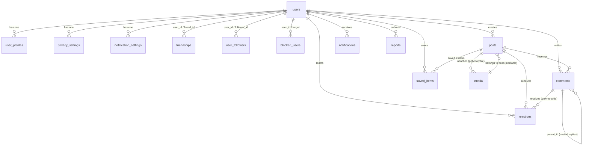

# Database Schema Specification: Professional Social Network Platform

## 1. Overview & Entity Relationship Diagram (ERD)

The database schema is fully normalized (3NF), optimized for transactional integrity, low latency read queries, and high-frequency social interactions.

---

## 2. Core Domain Table Specifications

### 2.1 `users`
Core user identity and authentication credentials.

| Column | Type | Constraints | Description |
| :--- | :--- | :--- | :--- |
| `id` | BIGINT UNSIGNED | PRIMARY KEY, AUTO_INCREMENT | Unique identifier |
| `name` | VARCHAR(255) | NULLABLE | Full display name |
| `username` | VARCHAR(50) | UNIQUE, NOT NULL | Alphanumeric unique handle |
| `email` | VARCHAR(255) | UNIQUE, NULLABLE | Primary email address |
| `email_verified_at` | TIMESTAMP | NULLABLE | Verification timestamp |
| `phone` | VARCHAR(30) | UNIQUE, NULLABLE | Mobile phone number (E.164) |
| `phone_verified_at` | TIMESTAMP | NULLABLE | Phone verification timestamp |
| `password` | VARCHAR(255) | NOT NULL | Bcrypt hash (rounds 12) |
| `status` | VARCHAR(20) | DEFAULT 'active' | `active`, `suspended`, `banned` |
| `last_login_at` | TIMESTAMP | NULLABLE | Timestamp of last login |
| `last_login_ip` | VARCHAR(45) | NULLABLE | IPv4 / IPv6 address |
| `two_factor_enabled` | BOOLEAN | DEFAULT FALSE | 2FA activation status |
| `two_factor_secret` | TEXT | NULLABLE, ENCRYPTED | TOTP secret key |
| `two_factor_recovery_codes`| TEXT | NULLABLE, ENCRYPTED | Backup recovery codes |
| `failed_login_attempts` | INT | DEFAULT 0 | Counter for brute-force lock |
| `locked_until` | TIMESTAMP | NULLABLE | Account lockout expiration |
| `remember_token` | VARCHAR(100) | NULLABLE | Web session persistent token |
| `created_at` | TIMESTAMP | NULLABLE | Record creation |
| `updated_at` | TIMESTAMP | NULLABLE | Record modification |
| `deleted_at` | TIMESTAMP | NULLABLE | Soft delete timestamp |

**Indexes**:
- `users_username_unique (username)`
- `users_email_unique (email)`
- `users_phone_unique (phone)`
- `users_status_idx (status)`

---

### 2.2 `user_profiles` (`profiles`)
Extended biographical and presentation details for a user.

| Column | Type | Constraints | Description |
| :--- | :--- | :--- | :--- |
| `id` | BIGINT UNSIGNED | PRIMARY KEY, AUTO_INCREMENT | Profile ID |
| `user_id` | BIGINT UNSIGNED | UNIQUE, FOREIGN KEY (`users.id`) ON DELETE CASCADE | Owner user |
| `first_name` | VARCHAR(100) | NULLABLE | First name |
| `last_name` | VARCHAR(100) | NULLABLE | Last name |
| `display_name` | VARCHAR(150) | NULLABLE | Public visible name |
| `avatar_url` | VARCHAR(500) | NULLABLE | Profile avatar image URL |
| `cover_photo_url` | VARCHAR(500) | NULLABLE | Profile banner cover image URL |
| `avatar_media_id` | BIGINT UNSIGNED | NULLABLE, FOREIGN KEY (`media.id`) ON DELETE SET NULL | Current avatar media reference |
| `cover_media_id` | BIGINT UNSIGNED | NULLABLE, FOREIGN KEY (`media.id`) ON DELETE SET NULL | Current cover media reference |
| `bio` | TEXT | NULLABLE | User biography / about text |
| `headline` | VARCHAR(255) | NULLABLE | Professional headline |
| `location` | VARCHAR(255) | NULLABLE | City / Region / Country |
| `website` | VARCHAR(255) | NULLABLE | Personal website URL |
| `birth_date` | DATE | NULLABLE | Date of birth |
| `gender` | VARCHAR(20) | NULLABLE | `male`, `female`, `custom`, `other` |
| `joined_date` | TIMESTAMP | NULLABLE | Platform join date |
| `created_at` | TIMESTAMP | NULLABLE | Timestamp |
| `updated_at` | TIMESTAMP | NULLABLE | Timestamp |

---

### 2.3 `friendships`
Bidirectional and pending social connections between users.

| Column | Type | Constraints | Description |
| :--- | :--- | :--- | :--- |
| `id` | BIGINT UNSIGNED | PRIMARY KEY, AUTO_INCREMENT | Connection ID |
| `user_id` | BIGINT UNSIGNED | FOREIGN KEY (`users.id`) ON DELETE CASCADE | Request initiator |
| `friend_id` | BIGINT UNSIGNED | FOREIGN KEY (`users.id`) ON DELETE CASCADE | Request recipient |
| `status` | VARCHAR(20) | NOT NULL, DEFAULT 'pending' | `pending`, `accepted`, `declined`, `blocked` |
| `is_favorite` | BOOLEAN | DEFAULT FALSE | Marked as favorite |
| `is_close_friend`| BOOLEAN | DEFAULT FALSE | Marked as close friend |
| `is_restricted` | BOOLEAN | DEFAULT FALSE | Restricted audience visibility |
| `requested_at` | TIMESTAMP | NULLABLE | Request dispatch time |
| `accepted_at` | TIMESTAMP | NULLABLE | Friendship acceptance time |
| `interacted_at` | TIMESTAMP | NULLABLE | Last social interaction |
| `created_at` | TIMESTAMP | NULLABLE | Record creation |
| `updated_at` | TIMESTAMP | NULLABLE | Record modification |

**Indexes & Constraints**:
- `UNIQUE KEY unique_friendship (user_id, friend_id)`
- `INDEX idx_friendships_user_status (user_id, status)`
- `INDEX idx_friendships_friend_status (friend_id, status)`
- `INDEX idx_friendships_pair (user_id, friend_id, status)`

---

### 2.4 `user_followers` (`follows`)
Unidirectional subscription model (following public accounts).

| Column | Type | Constraints | Description |
| :--- | :--- | :--- | :--- |
| `id` | BIGINT UNSIGNED | PRIMARY KEY, AUTO_INCREMENT | Follow ID |
| `user_id` | BIGINT UNSIGNED | FOREIGN KEY (`users.id`) ON DELETE CASCADE | Target user being followed |
| `follower_id` | BIGINT UNSIGNED | FOREIGN KEY (`users.id`) ON DELETE CASCADE | User performing follow |
| `created_at` | TIMESTAMP | NULLABLE | Follow timestamp |
| `updated_at` | TIMESTAMP | NULLABLE | Timestamp |

**Indexes & Constraints**:
- `UNIQUE KEY unique_user_follower (user_id, follower_id)`
- `INDEX idx_followers_follower (follower_id)`

---

### 2.5 `blocked_users` (`blocks`)
User-to-user and security blocking records.

| Column | Type | Constraints | Description |
| :--- | :--- | :--- | :--- |
| `id` | BIGINT UNSIGNED | PRIMARY KEY, AUTO_INCREMENT | Block ID |
| `user_id` | BIGINT UNSIGNED | NULLABLE, FOREIGN KEY (`users.id`) ON DELETE CASCADE | User initiating block |
| `identifier` | VARCHAR(255) | NOT NULL | Target user ID or IP string |
| `blocked_type` | VARCHAR(50) | DEFAULT 'user' | `user`, `ip`, `system` |
| `reason` | VARCHAR(255) | NULLABLE | Reason note |
| `blocked_at` | TIMESTAMP | NOT NULL | Block timestamp |
| `is_active` | BOOLEAN | DEFAULT TRUE | Active status |
| `created_at` | TIMESTAMP | NULLABLE | Timestamp |
| `updated_at` | TIMESTAMP | NULLABLE | Timestamp |

**Indexes**:
- `INDEX idx_blocked_user_identifier (user_id, identifier)`
- `INDEX idx_blocked_active (user_id, is_active)`

---

### 2.6 `posts`
Core social content created by users, pages, or groups.

| Column | Type | Constraints | Description |
| :--- | :--- | :--- | :--- |
| `id` | BIGINT UNSIGNED | PRIMARY KEY, AUTO_INCREMENT | Post ID |
| `user_id` | BIGINT UNSIGNED | FOREIGN KEY (`users.id`) ON DELETE CASCADE | Post author |
| `content` | TEXT | NULLABLE | Text body / caption |
| `audience` | VARCHAR(20) | DEFAULT 'public' | `public`, `friends`, `followers`, `only_me` |
| `type` | VARCHAR(30) | DEFAULT 'text' | `text`, `media`, `shared`, `poll` |
| `location` | VARCHAR(255) | NULLABLE | Geo location text |
| `feeling_activity`| VARCHAR(255)| NULLABLE | Feeling / activity indicator |
| `is_pinned` | BOOLEAN | DEFAULT FALSE | Pinned to top of author profile |
| `comments_disabled`| BOOLEAN | DEFAULT FALSE | Whether comments are locked |
| `likes_count` | INT | DEFAULT 0 | Denormalized reaction counter |
| `comments_count` | INT | DEFAULT 0 | Denormalized comment counter |
| `shares_count` | INT | DEFAULT 0 | Denormalized share counter |
| `status` | VARCHAR(20) | DEFAULT 'published' | `draft`, `scheduled`, `published` |
| `scheduled_at` | TIMESTAMP | NULLABLE | Publish time for scheduled posts |
| `created_at` | TIMESTAMP | NULLABLE | Creation timestamp |
| `updated_at` | TIMESTAMP | NULLABLE | Modification timestamp |
| `deleted_at` | TIMESTAMP | NULLABLE | Soft delete timestamp |

**Indexes & Composite Indexes (Crucial for News Feed)**:
- `INDEX idx_posts_feed (user_id, audience, status, scheduled_at, deleted_at, id)`
- `INDEX idx_posts_user_pinned (user_id, is_pinned, created_at)`
- `INDEX idx_posts_status_scheduled (status, scheduled_at)`

---

### 2.7 `media` & `post_media`
Polymorphic file asset storage and association.

| Column | Type | Constraints | Description |
| :--- | :--- | :--- | :--- |
| `id` | BIGINT UNSIGNED | PRIMARY KEY, AUTO_INCREMENT | Media ID |
| `user_id` | BIGINT UNSIGNED | FOREIGN KEY (`users.id`) ON DELETE CASCADE | Uploader |
| `mediable_type` | VARCHAR(255) | NULLABLE | Polymorphic target class (`App\Models\Post`, etc.) |
| `mediable_id` | BIGINT UNSIGNED | NULLABLE | Polymorphic target ID |
| `collection` | VARCHAR(50) | DEFAULT 'posts' | Collection name (`posts`, `avatars`, `covers`) |
| `disk` | VARCHAR(30) | DEFAULT 's3' | Storage disk (`s3`, `local`, `minio`) |
| `original_path` | VARCHAR(500) | NOT NULL | Path to original raw upload |
| `thumbnail_path`| VARCHAR(500) | NULLABLE | Path to 150x150 thumbnail |
| `medium_path` | VARCHAR(500) | NULLABLE | Path to 600x600 medium size |
| `large_path` | VARCHAR(500) | NULLABLE | Path to 1200x1200 large size |
| `mime_type` | VARCHAR(100) | NOT NULL | Verified MIME type |
| `size` | BIGINT UNSIGNED | NOT NULL | File size in bytes |
| `width` | INT | NULLABLE | Image width in pixels |
| `height` | INT | NULLABLE | Image height in pixels |
| `checksum` | VARCHAR(64) | NULLABLE | SHA-256 integrity hash |
| `processing_status`| VARCHAR(20)| DEFAULT 'completed' | `pending`, `processing`, `completed`, `failed` |
| `metadata` | JSON | NULLABLE | Extra dimensions, EXIF data |
| `created_at` | TIMESTAMP | NULLABLE | Timestamp |
| `updated_at` | TIMESTAMP | NULLABLE | Timestamp |

**Indexes**:
- `INDEX idx_media_mediable (mediable_type, mediable_id)`
- `INDEX idx_media_user_collection (user_id, collection)`

---

### 2.8 `comments`
Hierarchical comment threads on posts.

| Column | Type | Constraints | Description |
| :--- | :--- | :--- | :--- |
| `id` | BIGINT UNSIGNED | PRIMARY KEY, AUTO_INCREMENT | Comment ID |
| `post_id` | BIGINT UNSIGNED | FOREIGN KEY (`posts.id`) ON DELETE CASCADE | Associated post |
| `user_id` | BIGINT UNSIGNED | FOREIGN KEY (`users.id`) ON DELETE CASCADE | Author |
| `parent_id` | BIGINT UNSIGNED | NULLABLE, FOREIGN KEY (`comments.id`) ON DELETE CASCADE | Parent comment for replies |
| `body` | TEXT | NOT NULL | Comment text content |
| `likes_count` | INT | DEFAULT 0 | Denormalized reaction counter |
| `replies_count` | INT | DEFAULT 0 | Count of direct children replies |
| `created_at` | TIMESTAMP | NULLABLE | Timestamp |
| `updated_at` | TIMESTAMP | NULLABLE | Timestamp |
| `deleted_at` | TIMESTAMP | NULLABLE | Soft delete timestamp |

**Indexes**:
- `INDEX idx_comments_post_parent (post_id, parent_id, created_at)`
- `INDEX idx_comments_user (user_id)`

---

### 2.9 `reactions` (`post_reactions`)
Polymorphic emoji and sentiment reactions on posts, comments, stories, and reels.

| Column | Type | Constraints | Description |
| :--- | :--- | :--- | :--- |
| `id` | BIGINT UNSIGNED | PRIMARY KEY, AUTO_INCREMENT | Reaction ID |
| `user_id` | BIGINT UNSIGNED | FOREIGN KEY (`users.id`) ON DELETE CASCADE | User reacting |
| `reactable_type`| VARCHAR(255) | NOT NULL | Target class (`App\Models\Post`, `App\Models\Comment`) |
| `reactable_id` | BIGINT UNSIGNED | NOT NULL | Target entity ID |
| `type` | VARCHAR(20) | NOT NULL, DEFAULT 'like' | `like`, `love`, `care`, `haha`, `wow`, `sad`, `angry` |
| `created_at` | TIMESTAMP | NULLABLE | Timestamp |
| `updated_at` | TIMESTAMP | NULLABLE | Timestamp |

**Indexes & Constraints**:
- `UNIQUE KEY unique_user_reaction (user_id, reactable_type, reactable_id)`
- `INDEX idx_reactions_target (reactable_type, reactable_id, type)`

---

### 2.10 `saved_items` (`saved_posts`)
Bookmarks and saved posts for later viewing.

| Column | Type | Constraints | Description |
| :--- | :--- | :--- | :--- |
| `id` | BIGINT UNSIGNED | PRIMARY KEY, AUTO_INCREMENT | Saved item ID |
| `user_id` | BIGINT UNSIGNED | FOREIGN KEY (`users.id`) ON DELETE CASCADE | User who saved |
| `item_type` | VARCHAR(255) | NOT NULL | `App\Models\Post` |
| `item_id` | BIGINT UNSIGNED | NOT NULL | Saved entity ID |
| `collection_name`| VARCHAR(100)| DEFAULT 'default' | User folder / collection |
| `created_at` | TIMESTAMP | NULLABLE | Timestamp |
| `updated_at` | TIMESTAMP | NULLABLE | Timestamp |

**Indexes & Constraints**:
- `UNIQUE KEY unique_saved_item (user_id, item_type, item_id)`
- `INDEX idx_saved_user_collection (user_id, collection_name)`

---

### 2.11 `notifications`
Laravel standard polymorphic database notification store.

| Column | Type | Constraints | Description |
| :--- | :--- | :--- | :--- |
| `id` | CHAR(36) | PRIMARY KEY (UUID) | Notification UUID |
| `type` | VARCHAR(255) | NOT NULL | Notification event class |
| `notifiable_type`| VARCHAR(255)| NOT NULL | Receiver model (`App\Models\User`) |
| `notifiable_id` | BIGINT UNSIGNED| NOT NULL | Receiver ID |
| `data` | TEXT / JSON | NOT NULL | Payload details (actor, entity, URL, excerpt) |
| `read_at` | TIMESTAMP | NULLABLE | Timestamp when marked as read |
| `created_at` | TIMESTAMP | NULLABLE | Dispatch timestamp |
| `updated_at` | TIMESTAMP | NULLABLE | Timestamp |

**Indexes**:
- `INDEX idx_notifications_notifiable (notifiable_type, notifiable_id, read_at)`

---

### 2.12 `reports`
User moderation reports on abusive content or profiles.

| Column | Type | Constraints | Description |
| :--- | :--- | :--- | :--- |
| `id` | BIGINT UNSIGNED | PRIMARY KEY, AUTO_INCREMENT | Report ID |
| `reporter_id` | BIGINT UNSIGNED | FOREIGN KEY (`users.id`) ON DELETE CASCADE | Submitting user |
| `reportable_type`| VARCHAR(255)| NOT NULL | Target entity type (`Post`, `Comment`, `User`) |
| `reportable_id` | BIGINT UNSIGNED| NOT NULL | Target entity ID |
| `reason` | VARCHAR(100) | NOT NULL | `spam`, `harassment`, `hate_speech`, `violence`, `other` |
| `details` | TEXT | NULLABLE | Detailed description from reporter |
| `status` | VARCHAR(20) | DEFAULT 'pending' | `pending`, `reviewed`, `resolved`, `dismissed` |
| `reviewed_by` | BIGINT UNSIGNED | NULLABLE, FOREIGN KEY (`users.id`) ON DELETE SET NULL | Moderator ID |
| `reviewed_at` | TIMESTAMP | NULLABLE | Resolution timestamp |
| `admin_notes` | TEXT | NULLABLE | Internal staff notes |
| `created_at` | TIMESTAMP | NULLABLE | Timestamp |
| `updated_at` | TIMESTAMP | NULLABLE | Timestamp |

**Indexes**:
- `INDEX idx_reports_status (status, created_at)`
- `INDEX idx_reports_reportable (reportable_type, reportable_id)`

---

### 2.13 Messaging Tables (Planned Phase)
- `conversations` (`id`, `type`, `title`, `created_by`, `last_message_at`)
- `conversation_participants` (`id`, `conversation_id`, `user_id`, `role`, `last_read_at`)
- `messages` (`id`, `conversation_id`, `user_id`, `body`, `type`, `is_read`, `created_at`)

---

## 3. Seeders & Factories Matrix

All core models are backed by complete Eloquent Factories:
- `UserFactory`: Creates users with randomized names, usernames, verified emails.
- `UserProfileFactory`: Creates rich bios, avatars, and location data.
- `PostFactory`: Generates posts across diverse audiences (`public`, `friends`) with optional media attachments.
- `CommentFactory`: Creates root and nested child comments.
- `FriendshipFactory`: Generates pending, accepted, and declined friendships.
- `DatabaseSeeder`: Seeds a complete test social graph with realistic relationships and interactions for local development.
