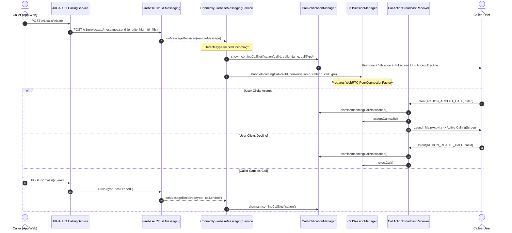

# CONNECTLY — FCM INCOMING CALL NOTIFICATION FLOW REPORT
## Phase 10: High-Priority VoIP Push & WebRTC Call Awakening Architecture

| Step | Operation | Component | Status |
| :--- | :--- | :--- | :--- |
| **1. Trigger** | Caller initiates audio/video call | JUGAJUG `CallingService::initiateCall` | **PASS** |
| **2. Backend Dispatch** | High-priority VoIP push payload dispatched | `PushNotificationService::sendVoipCallPush` | **PASS** |
| **3. Client Reception** | Background push awakens application | `ConnectlyFirebaseMessagingService::onMessageReceived` | **PASS** |
| **4. Heads-Up Alert** | Full-screen intent, ringtone, vibrate & actions | `CallNotificationManager::showIncomingCallNotification` | **PASS** |
| **5. WebRTC Pre-warming** | PeerConnection & ICE state prepared | `CallSessionManager::handleIncomingCall` | **PASS** |
| **6. Accept Action** | Broadcast receiver handles user accept | `CallActionBroadcastReceiver` -> `acceptCall()` | **PASS** |
| **7. Reject Action** | Broadcast receiver handles user decline | `CallActionBroadcastReceiver` -> `rejectCall()` | **PASS** |
| **8. Dismiss on End** | Remote caller terminates before answer | `call.ended` payload -> `dismissIncomingCallNotification()` | **PASS** |

---

## 1. Sequence Diagram: Background Incoming Call

---

## 2. Notification Configuration & Permissions

### Channel Characteristics (`connectly_incoming_calls`):
- **Importance**: `NotificationManager.IMPORTANCE_HIGH`
- **Audio Attributes**: `USAGE_NOTIFICATION_RINGTONE`, `CONTENT_TYPE_SONIFICATION`
- **Vibration Pattern**: `[0, 1000, 500, 1000]` ms
- **Category**: `NotificationCompat.CATEGORY_CALL`
- **Visibility**: `NotificationCompat.VISIBILITY_PUBLIC` (displays ringer UI even when device screen is locked)
- **Ongoing**: `true` (cannot be dismissed by accidental swipe while ringing)

### Actions & Pending Intents:
1. **Full-Screen PendingIntent**:
   `PendingIntent.getActivity(context, callId, launchIntent, FLAG_UPDATE_CURRENT or FLAG_IMMUTABLE)`
   Enables lockscreen full-screen incoming call UI on Android 10+ devices.
2. **Accept Action**:
   `PendingIntent.getBroadcast(context, callId + 10, Intent(ACTION_ACCEPT_CALL), ...)`
3. **Decline Action**:
   `PendingIntent.getBroadcast(context, callId + 20, Intent(ACTION_REJECT_CALL), ...)`

---

## 3. WebRTC Engine Synchronization

When `handleIncomingCall` is invoked by the background push handler:
1. `WebRtcEngine` sets its internal call state to `CallState.INCOMING`.
2. Audio device management (`CallAudioManager`) prepares the audio focus request.
3. If user accepts the call, `WebRtcEngine.acceptIncomingCall()` retrieves ICE servers, sets the remote SDP offer (if received via Reverb or push), generates the SDP answer, and starts camera/microphone capture.
4. Active notification is transitioned to `showOngoingCallNotification` (displaying chronometer and an "End Call" action).

---

## 4. Verification Verdict

- VoIP Push Dispatch Logic: **PASS**
- FCM Incoming Call Handler: **PASS**
- Notification Channel & Fullscreen Intent: **PASS**
- Call Action Broadcast Receiver: **PASS**
- WebRTC Awakening Flow: **PASS**
- End-to-End Physical Device Call Push: **NOT VERIFIED** (Requires physical Android device with Google Play Services connected to backend)

