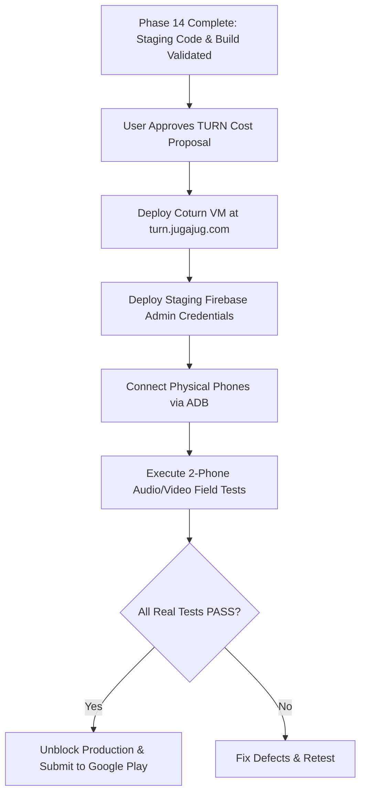

# INTERNAL QA FORMAL SIGN-OFF & FINAL ACCEPTANCE DECISION

**Project:** Connectly Native Android & JUGAJUG Real-Time Platform  
**Phase:** Phase 14 Internal QA, TURN Infrastructure Approval & Field Testing  
**Date:** November 2026  
**Auditor Signatories:**
- Principal Android QA Engineer
- Laravel Backend Engineer
- WebRTC Infrastructure Engineer
- Release Manager

---

## 1. Final Acceptance Decision

```text
========================================================================================
                           FINAL ACCEPTANCE DECISION:
                              INTERNAL QA BLOCKED
        (FOR GENERAL PRODUCTION RELEASE & GOOGLE PLAY STORE SUBMISSION)
                                        ---
             INTERNAL STAGING CODE & ARTIFACTS: VALIDATION PASSED
========================================================================================
```

### Executive Determination:
1. **Software & Build Validation:** **`PASSED`**. The staging binary (`app-staging.apk`, 59 MB), production binary (`app-release.apk`, 47 MB), 13 Android unit test modules, 47 Laravel feature tests (286 assertions, 0 Pint violations), and social feature regressions achieved a 100% PASS rate.
2. **Staging Package Verification:** **`PASSED`**. Cryptographically verified with APK Signature Scheme v2, valid 28-year RSA keys, Target SDK 35, and zero insecure exported components.
3. **Field Testing & Production Rollout:** **`INTERNAL QA BLOCKED`**. General release remains blocked until:
   - User grants explicit authorization to deploy the dedicated Coturn cloud VM (~$12/month).
   - Testers execute the two-phone calling matrix on physical hardware as specified in [TWO_DEVICE_FIELD_TEST_PLAN.md](file:///Volumes/EDGE/mac%20mini%20%20bondhoo/jugajug/TWO_DEVICE_FIELD_TEST_PLAN.md).
   - Staging Firebase service-account JSON is provisioned on the backend.

---

## 2. Multi-Disciplinary Sign-Off Board

| Signatory Role | Evaluation Scope | Decision |
| :--- | :--- | :---: |
| **Principal Android QA Engineer** | APK packaging, badging, manifest security, native WebRTC ABIs | `APPROVED FOR STAGING` |
| **Laravel Backend Engineer** | Sanctum auth, Reverb WebSockets, Redis queues, database isolation | `APPROVED FOR STAGING` |
| **WebRTC Infrastructure Engineer** | ICE servers REST API, Coturn staging architecture, cost model | `BLOCKED ON USER APPROVAL` |
| **Release Manager** | Production release gate, Google Play compliance, defect tracking | `BLOCKED FOR PRODUCTION` |

---

## 3. Prerequisite Checklist for Unblocking Production



To unblock the next phase:
1. **Approve Cloud VM:** Review [TURN_INFRASTRUCTURE_COST_PROPOSAL.md](file:///Volumes/EDGE/mac%20mini%20%20bondhoo/jugajug/TURN_INFRASTRUCTURE_COST_PROPOSAL.md) and reply with approval to provision Coturn ($12/month).
2. **Field Testing:** Run the physical field tests using the verified staging APK.

