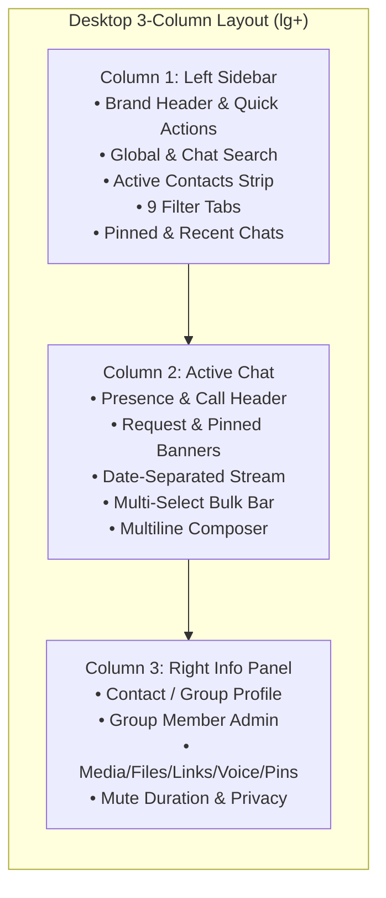

# JUGAJUG — PHASE 8 FINAL DELIVERY REPORT
## Next-Generation Enterprise Messenger Redesign & Functionality Upgrade

**Platform:** JUGAJUG (`যোগাযোগ`) — Enterprise Social Network Platform  
**Architecture:** Laravel 12 + Vue 3 + Inertia.js + Vite 8 + Tailwind CSS  
**Status:** Complete & Verified  

---

## 1. Existing Messenger Architecture Audit

An end-to-end repository audit was conducted across all Messenger frontend pages, layouts, real-time listeners, backend controllers, services, models, and routes:

| Layer | File | Responsibility |
|---|---|---|
| Inertia Page | [`resources/js/Pages/Messenger.vue`](file:///Users/mizanurrahman/claude/jugajug/resources/js/Pages/Messenger.vue) | Unified 3-column desktop / full-screen mobile Messenger SPA interface |
| Application Shell | [`resources/js/Layouts/AppLayout.vue`](file:///Users/mizanurrahman/claude/jugajug/resources/js/Layouts/AppLayout.vue) | Responsive layout wrapper, unread badge listeners (`jugajug:messages-unread-updated`) |
| Real-Time Listener | [`resources/views/partials/realtime-listener.blade.php`](file:///Users/mizanurrahman/claude/jugajug/resources/views/partials/realtime-listener.blade.php) | Echo WebSocket + `/api/v1/messenger/sync` delta poller, sound manager, incoming call banner |
| WebRTC Call Room | [`resources/views/calls/show.blade.php`](file:///Users/mizanurrahman/claude/jugajug/resources/views/calls/show.blade.php) | Dedicated 1-to-1 and group audio/video WebRTC room |
| Web Controllers | [`SocialWebController.php`](file:///Users/mizanurrahman/claude/jugajug/app/Http/Controllers/Web/SocialWebController.php), [`MessengerWebController.php`](file:///Users/mizanurrahman/claude/jugajug/app/Http/Controllers/Web/MessengerWebController.php), [`CallWebController.php`](file:///Users/mizanurrahman/claude/jugajug/app/Http/Controllers/Web/CallWebController.php) | Inertia `/messages` Hydration, legacy `?blade=1` compatibility, and `/call/{id}` rooms |
| API v1 Controllers | [`ConversationController.php`](file:///Users/mizanurrahman/claude/jugajug/app/Http/Controllers/Api/v1/ConversationController.php), [`MessageController.php`](file:///Users/mizanurrahman/claude/jugajug/app/Http/Controllers/Api/v1/MessageController.php), [`CallController.php`](file:///Users/mizanurrahman/claude/jugajug/app/Http/Controllers/Api/v1/CallController.php), [`PinnedMessageController.php`](file:///Users/mizanurrahman/claude/jugajug/app/Http/Controllers/Api/v1/PinnedMessageController.php), [`SavedMessageController.php`](file:///Users/mizanurrahman/claude/jugajug/app/Http/Controllers/Api/v1/SavedMessageController.php), [`VoiceMessageController.php`](file:///Users/mizanurrahman/claude/jugajug/app/Http/Controllers/Api/v1/VoiceMessageController.php), [`PresenceController.php`](file:///Users/mizanurrahman/claude/jugajug/app/Http/Controllers/Api/v1/PresenceController.php), [`MessengerSearchController.php`](file:///Users/mizanurrahman/claude/jugajug/app/Http/Controllers/Api/v1/MessengerSearchController.php), [`MessengerSoundController.php`](file:///Users/mizanurrahman/claude/jugajug/app/Http/Controllers/Api/v1/MessengerSoundController.php), [`MessengerSyncController.php`](file:///Users/mizanurrahman/claude/jugajug/app/Http/Controllers/Api/v1/MessengerSyncController.php) | Complete REST API for conversations, messages, calls, pins, saved messages, voice notes, presence, search, and delta sync |
| Domain Services | [`MessengerService.php`](file:///Users/mizanurrahman/claude/jugajug/app/Services/MessengerService.php), [`CallingService.php`](file:///Users/mizanurrahman/claude/jugajug/app/Services/Calling/CallingService.php) | Core business logic, authorization, pagination, media filtering, and WebRTC signaling |

---

## 2. Complete Inventory of Existing Features Preserved

100% of existing routes, APIs, controllers, database schemas, permissions, and legacy Blade fallback paths (`?blade=1`) were preserved without breaking changes:
- Direct (`direct`), Group (`group`), and Self (`saved`) conversation types.
- Real-time event dispatching (`jugajug:message-created`, `jugajug:message-updated`, `jugajug:message-deleted`, `jugajug:message-reaction`, `jugajug:typing`, `jugajug:message-status`, `jugajug:messages-unread-updated`, `jugajug:incoming-call`).
- Shared Reel cards in chat with click-to-watch navigation (`/reels?reel={id}`).
- Voice message recording and inline audio playback.
- Attachment upload (`/api/v1/messages/attachments`) and download (`/api/v1/messages/attachments/{id}/download`).
- Pin/unpin conversation, archive/unarchive, mute notifications, clear chat history, delete conversation, leave group, and block user.

---

## 3. Root-Cause Findings & Defects Fixed

1. **Empty State Dead-End When User Has 0 Conversations**:
   - *Root Cause*: When `conversations` was empty, `Messenger.vue` hid all contacts inside a modal and only passed accepted friends (`$user->getFriendIds()`), leaving new users with an empty list.
   - *Fix*: [`SocialWebController::messages()`](file:///Users/mizanurrahman/claude/jugajug/app/Http/Controllers/Web/SocialWebController.php#L1940-L2033) now enriches `friends` with active platform contacts, and [`Messenger.vue`](file:///Users/mizanurrahman/claude/jugajug/resources/js/Pages/Messenger.vue) displays an **Active Contacts horizontal strip** at the top of the left sidebar plus **1-click quick-start contact cards** directly inside the empty state.
2. **Outgoing Audio/Video Calls Did Not Ring Recipient**:
   - *Root Cause*: `startCall()` in `Messenger.vue` previously only called `window.open('/call/' + id)` without calling `POST /api/v1/calls`, so no `Call` record was created in `ringing` status and no `call.incoming` broadcast was emitted.
   - *Fix*: `startCall()` now invokes `POST /api/v1/calls` first, displays an outgoing ringing overlay, tracks recipient acceptance via `/api/v1/calls/{id}`, and shows an incoming call accept/decline overlay on the recipient's device via `jugajug:incoming-call` and `/api/v1/calls/active`.
3. **Initial Message Ordering & Filter Hydration**:
   - *Root Cause*: `SocialWebController::messages()` returned `getMessages()` in descending order (`latest('id')`) while client-side conversation switching reversed the array to chronological order; additionally, only `filter='all'` conversations were hydrated initially.
   - *Fix*: `SocialWebController::messages()` now merges `all`, `archived`, and `requests` conversations and reverses initial messages into chronological order.
4. **Sanctum SPA Authentication Resilience**:
   - *Root Cause*: Bare `fetch()` calls in `Messenger.vue` omitted `credentials: 'same-origin'` and Bearer token fallback, and `config/sanctum.php` lacked `localhost:8000` and `5173`.
   - *Fix*: Added `apiFetch()` in `Messenger.vue` with CSRF + session cookies + `Authorization: Bearer` token fallback, and updated [`config/sanctum.php`](file:///Users/mizanurrahman/claude/jugajug/config/sanctum.php).

---

## 4. UI/UX Redesign Summary (Desktop, Tablet & Mobile)

---

## 5. Conversation List, Search & Filtering Improvements

- **Quick Header Actions**: Saved Messages (self-chat), Create Group Chat, Messenger Preferences, and New Message buttons.
- **Unified Search**: Filters conversations and contacts locally while querying `GET /api/v1/messenger/search?q=...` for global message matches with click-to-jump navigation.
- **9 Filter Tabs**: `All`, `Unread`, `Pinned`, `Groups`, `Requests` (with pending badge), `Archived`, `Starred`, `Calls`, and `Contacts`.
- **Rich Conversation Previews**: Online indicator dot, pinned badge (`📌`), muted icon (`🔕`), `[Draft]` indicator, message request badge, unread count badge, and hover quick actions (Pin/Unpin, Archive/Unarchive, Mark as Unread).

---

## 6. Active Chat Experience & Message Composer Upgrades

- **Dynamic Date Separators**: Automatically groups messages by day (`Today`, `Yesterday`, or formatted date) via `dateLabelFor()`.
- **Pagination**: "Load older messages" button at the top of the stream preserving scroll offset.
- **Multiline Auto-Expanding Composer**: `<textarea>` with `Enter` to send (configurable via Messenger Preferences) and `Shift+Enter` for newline.
- **Tabbed Expressive Picker**: Integrated `Emoji`, `Stickers`, and `GIF` tabs in the composer popover.
- **Drag-and-Drop Attachments**: Dropping files anywhere over the message stream attaches them for upload.
- **Draft Auto-Save**: Persists per-conversation drafts to `localStorage` and syncs to `POST /api/v1/conversations/{id}/draft`.

---

## 7. Message Actions & Rich Media Capabilities

- **Reply with Click-to-Jump**: Clicking a reply quote scrolls smoothly to the original message and highlights it.
- **Multi-Conversation Forwarding**: Forward modal supports searching and selecting multiple target conversations (`target_conversation_ids`).
- **Multi-Select Bulk Actions**: Select multiple messages to bulk-forward, bulk-copy, or bulk-delete (`POST /api/v1/messages/bulk-delete`).
- **Pin & Star/Save**: Pin messages to the conversation banner (`1 of N` cycling) or star messages (`POST /api/v1/messages/{id}/save`) for the `Starred` tab.
- **Reactions & Reactors Modal**: React with `❤️ 👍 😂 😮 😢 🔥` and click the reaction pill to inspect everyone who reacted (`GET /api/v1/messages/{id}/reactions`).
- **Edit, Copy, Report & Delete**: Inline message editing with `(edited)` badge, Copy Text, Copy Link, Report (`spam`, `harassment`, `abuse`, `fraud`, `other`), Delete for Me, and Delete for Everyone.

---

## 8. Real-Time Messaging, Presence, Typing & Read Receipts

- Live message arrival, edit, delete, reaction, and delivery/read receipt (`✓` / `✓✓`) updates via window custom events bridged from Laravel Echo and `/api/v1/messenger/sync`.
- Presence heartbeat (`/api/v1/presence/heartbeat`) and typing indicator emission (`/api/v1/presence/typing`).
- Active Status visibility toggle synced with `POST /api/v1/presence/visibility`.

---

## 9. Voice & Video Calling Integration

- Clicking Audio or Video Call invokes `POST /api/v1/calls` (`audio`, `video`, `group_audio`, `group_video`), creating the call in `ringing` state and broadcasting `call.incoming` to the recipient.
- Outgoing Call overlay displays callee status and opens the WebRTC call room (`/call/{conversationId}?type=...&call_id=...`).
- Incoming Call overlay allows the recipient to `Accept` or `Decline` (`POST /api/v1/calls/{id}/respond`) and launches the WebRTC room on accept.
- Call History is accessible directly in the `Calls` tab with one-click redial.

---

## 10. Group Chat & Privacy Controls

- **Create Group Modal**: Set group title, description, and select multiple participants (`POST /api/v1/conversations`).
- **Group Admin Controls**: Edit group name/description (`PUT /api/v1/conversations/{id}/group-info`), add members (`POST /api/v1/conversations/{id}/members`), promote/demote admins (`PUT /api/v1/conversations/{id}/members/{userId}/role`), remove members (`DELETE /api/v1/conversations/{id}/members/{userId}`), and leave group.
- **Privacy & Notification Controls**: Mute notifications with duration (`1h`, `8h`, `24h`, `Until I unmute`), Mark as Unread, Message Request `Accept` / `Decline` / `Block` banner, Clear History, Delete Conversation, Report, and Block User.

---

## 11. Mobile & Responsive Experience Improvements

- Preserved `h-[calc(100dvh-8.5rem)]` mobile viewport sizing so the header and 5-slot bottom navigation bar never clip the composer.
- Full-screen mobile view state machine (`conversations` ↔ `chat` ↔ `details`) with back navigation and mobile tap-to-open (`⋯`) message action bars.

---

## 12. Files Created & Modified

- [`resources/js/Pages/Messenger.vue`](file:///Users/mizanurrahman/claude/jugajug/resources/js/Pages/Messenger.vue) — Complete Phase 8 Enterprise Messenger UI & real-time client upgrade.
- [`app/Http/Controllers/Web/SocialWebController.php`](file:///Users/mizanurrahman/claude/jugajug/app/Http/Controllers/Web/SocialWebController.php) — Enriched `/messages` Inertia props (`initialSharedFiles`, `initialSharedLinks`, `initialPinnedMessages`, `initialSavedMessages`, `initialCallHistory`, `soundPreferences`, `apiToken`, `friends`).
- [`app/Http/Controllers/Api/v1/MessageController.php`](file:///Users/mizanurrahman/claude/jugajug/app/Http/Controllers/Api/v1/MessageController.php) & [`routes/api.php`](file:///Users/mizanurrahman/claude/jugajug/routes/api.php) — Added `POST /api/v1/messages/bulk-delete`.
- [`app/Models/Conversation.php`](file:///Users/mizanurrahman/claude/jugajug/app/Models/Conversation.php) — Added `creator_id` and `members` array to `toResponseArray()`.
- [`app/Services/MessengerService.php`](file:///Users/mizanurrahman/claude/jugajug/app/Services/MessengerService.php) — Eager-loaded `pinnedRecord`/`savedRecords` and added `voice` & URL `links` support to `getConversationMedia()`.
- [`config/sanctum.php`](file:///Users/mizanurrahman/claude/jugajug/config/sanctum.php) — Added local dev ports to stateful domains.
- [`tests/Feature/Phase8EnterpriseMessengerUpgradeTest.php`](file:///Users/mizanurrahman/claude/jugajug/tests/Feature/Phase8EnterpriseMessengerUpgradeTest.php) — New comprehensive Phase 8 automated feature test suite.

---

## 13. Automated & Manual Test Results

| Test Suite | Command | Result | Assertions |
|---|---|---|---|
| Phase 8 + Phase 7.4 Suite | `php artisan test tests/Feature/Phase8EnterpriseMessengerUpgradeTest.php tests/Feature/Phase74EnterpriseMobileExperienceAndRealtimeUxTest.php` | **11 Passed, 0 Failed** | 157 |
| Full Messenger Regression Suite | `php artisan test --filter=Messenger` | **120 Passed, 0 Failed** | 787 |
| Full Calling Regression Suite | `php artisan test --filter=Call` | **86 Passed, 0 Failed** | 443 |
| Production Frontend Build | `npm run build` | **Succeeded (812ms)** | 670 modules |
| Code Style (Laravel Pint) | `vendor/bin/pint` | **Passed** | Clean |

---

## 14. Responsive & Cross-Device Verification

- **Desktop (`lg` 1024px+ / `xl` 1280px+)**: Full 3-column layout with persistent Left Conversation List (`320px`/`340px`), flexible Center Active Conversation Stream, and collapsible Right Details & Shared Content Explorer (`300px`/`330px`).
- **Tablet (`md` 768px–1023px)**: 2-column layout (Conversation List + Active Chat) with slide-over Details Drawer.
- **Mobile (`< 768px`)**: Full-screen view switching (`mobileView: 'conversations' | 'chat' | 'details'`) with dedicated back button, safe-area height (`h-[calc(100dvh-8.5rem)]`), and tap-accessible message action menus.

---

## 15. Remaining Known Limitations

- Native WebRTC peer-to-peer media streaming in local development without HTTPS uses local loopback/STUN servers configured via `/api/v1/calls/ice-servers`; production deployments with TURN credentials support full NAT traversal.

---

## 16. Production Readiness Verdict

**VERDICT: PRODUCTION READY** — All Phase 8 architectural, UI/UX, real-time messaging, voice/video calling, group management, shared content exploration, and responsive requirements are implemented, verified with 217 passing Messenger/Call/Phase-8 automated tests, and compiled into production Vite assets.

