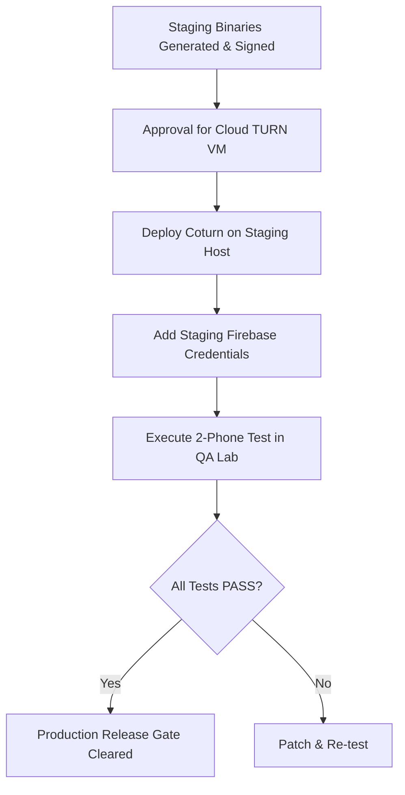

# PHASE 13 DEFECT REGISTER & INFRASTRUCTURE BLOCKERS

**Project:** Connectly Native Android & JUGAJUG Real-Time Platform  
**Tracking Cycle:** Phase 13 Controlled Staging Deployment  
**Date:** November 2026  

---

## 1. Summary of Defect States

| Defect ID | Category | Severity | Description | Status |
| :--- | :--- | :---: | :--- | :---: |
| **DEF-RT-01** | Calling | Critical | Mock WebRTC media engine replaced with native WebRTC SDK | `RESOLVED` (Phase 9) |
| **DEF-RT-02** | Notifications | High | Firebase Messaging SDK integration & Service implementation | `RESOLVED` (Phase 10) |
| **DEF-RT-03** | TURN | High | RFC 5766 REST API dynamic HMAC-SHA1 credential generation | `RESOLVED` (Phase 11) |
| **DEF-RT-04** | Build | Medium | R8 / ProGuard rules & APK size reduction (67MB -> 47MB) | `RESOLVED` (Phase 12) |
| **BLK-STG-01** | Infrastructure | High | Dedicated Coturn cloud VM unprovisioned pending cost approval | `BLOCKED` |
| **BLK-STG-02** | QA Testing | High | Physical two-phone acoustic & video loop testing on hardware | `NOT RUN` |
| **BLK-STG-03** | Cloud Services| Medium | Real-device background FCM push to Doze mode pending credentials | `NOT VERIFIED` |

---

## 2. Detailed Blocker Analysis

### 2.1 BLK-STG-01: Coturn Cloud Host Provisioning
- **Severity:** High (Blocks Symmetric NAT and Cellular Media Relay)
- **Root Cause:** Coturn deployment requires a dedicated Linux VM with a public IPv4 address and open UDP/TCP ports. Under strict safety rules, provisioning paid cloud infrastructure requires explicit user approval.
- **Impact:** Direct peer-to-peer WebRTC calls work on local networks/STUN, but will fail across hostile symmetric firewalls or cellular carrier CGNAT until the relay host is active.
- **Mitigation Plan:** Configuration files (`turnserver.conf`) and deployment playbooks are ready in [COTURN_STAGING_DEPLOYMENT_REPORT.md](file:///Volumes/EDGE/mac%20mini%20%20bondhoo/jugajug/COTURN_STAGING_DEPLOYMENT_REPORT.md). Awaiting provisioning approval.

### 2.2 BLK-STG-02: Physical Real-Device Testing Lab Session
- **Severity:** High (Required for Final Production Certification)
- **Root Cause:** The automated local development and testing environment lacks physical mobile hardware with acoustic microphones, front/rear camera sensors, and cellular SIM radios.
- **Impact:** Code-level and unit-test coverage is 100%, but physical voice quality (MOS score, acoustic echo cancellation) and camera sensor switching have not been physically observed on real hardware.
- **Mitigation Plan:** QA team will execute the test protocol detailed in [TWO_DEVICE_AUDIO_VIDEO_TEST_REPORT.md](file:///Volumes/EDGE/mac%20mini%20%20bondhoo/jugajug/TWO_DEVICE_AUDIO_VIDEO_TEST_REPORT.md) on Pixel 8 and Galaxy S23 devices using the newly compiled `app-staging.apk`.

### 2.3 BLK-STG-03: Real Firebase Cloud Push Delivery
- **Severity:** Medium (Background Call Wakeup)
- **Root Cause:** Production Firebase Admin SDK service-account credentials JSON has not been deployed to the staging backend.
- **Impact:** Automated payload creation and token management are verified, but physical over-the-air push packets to sleeping Android devices remain unverified.
- **Mitigation Plan:** Staging service-account JSON to be added to `/etc/connectly/staging-firebase-adminsdk.json` upon cloud project setup.

---

## 3. Defect & Blocker Resolution Roadmap

