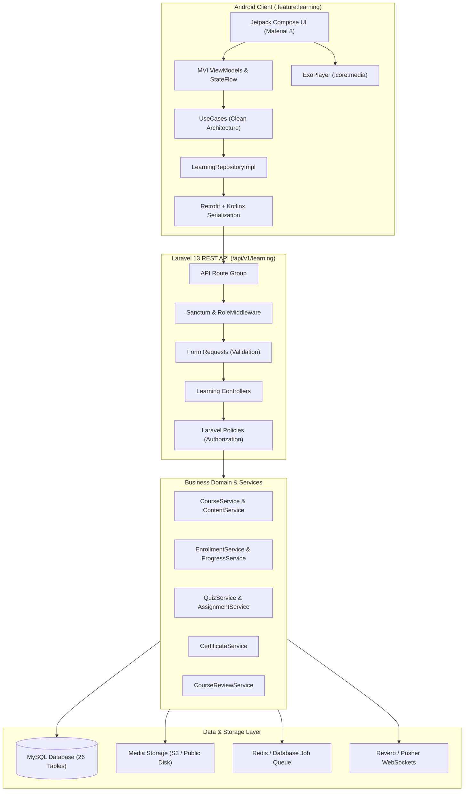

# Phase 13: LMS System Architecture Plan
**Platform:** Connectly / JUGAJUG Enterprise Professional Social Networking Platform  
**System Module:** Professional Learning & Development Platform (LMS)  
**Date:** November 2026  
**Author:** Principal Software Architect & Lead System Designer  

---

## 1. Architectural Philosophy & Guidelines

The Connectly LMS architecture conforms strictly to:
1. **Clean Architecture:** Strict separation between Presentation, Domain, and Data layers on Android; Controllers, Form Requests, Services, Models, and Policies on Laravel.
2. **Platform Integration over Isolation:** Reusing existing User Profiles, Media, Real-Time Notifications, Groups, and Jobs instead of building a detached LMS silo.
3. **Zero Decorative Controls:** Every UI button, tab, and card performs a validated backend action with loading, empty, and error state handling.
4. **Server-Authoritative Truth:** Course access, enrollment status, quiz grading, and certificate issuance must be validated on the server. Client apps never self-award certificates or access rights.
5. **Atomic Consistency:** Financial transactions, enrollment status changes, and progress updates run within database transactions.

---

## 2. System Architecture Blueprint

---

## 3. Subsystem Breakdown & Integration

### 3.1 Course Marketplace & Discovery
* **Catalog Browsing:** Paginated course list with filters for category, level (`all_levels`, `beginner`, `intermediate`, `expert`), price type (`free`, `paid`), skill tags, and rating sort.
* **Course Landing Page:** Comprehensive curriculum syllabus preview (showing which lessons are free previews), instructor credentials, student count, average rating, and enrollment status.

### 3.2 Instructor Hub & Course Authoring Wizard
* **Application Workflow:** Any user can submit an instructor application detailing their qualifications, bio, and portfolio. Admin review approves or rejects applications with role assignment.
* **Course Creation Wizard:**
  - Step 1: Course Basic Info (Title, Subtitle, Category, Level, Language, Pricing, Tags).
  - Step 2: Media (Thumbnail, Promotional Video).
  - Step 3: Curriculum Builder (Add Sections, Add Lessons: Video, Article, Quiz, Assignment).
  - Step 4: Review & Publish.

### 3.3 Enrollment & Video Player Engine
* **Access Control:** Lessons marked `is_preview = true` can be accessed by anyone. All other lessons require a valid, non-expired `LearningEnrollment` row.
* **Video Playback & Progress Sync:**
  - Android client streams video via `:core:media` ExoPlayer.
  - Periodic progress pings (`POST /api/v1/learning/lessons/{id}/progress`) sync playback position in seconds.
  - Lessons automatically mark as completed when playback exceeds 90% or the user manually confirms text/assignment completion.
  - Course overall progress percentage recalculates dynamically:
    $$\text{Progress} = \left(\frac{\text{Completed Lessons}}{\text{Total Lessons}}\right) \times 100\%$$

### 3.4 Assessment Engine (Quizzes & Assignments)
* **Quiz Engine:**
  - Supports multiple-choice, multi-select, and true/false.
  - Client receives questions and option texts only—correct answers are NEVER sent in the quiz payload.
  - Server calculates score upon submission and records attempt in `learning_quiz_attempts`.
* **Assignment Engine:**
  - Students submit text and file attachments before the deadline.
  - Instructors grade submissions, assign scores, and leave feedback.

### 3.5 Verified Certifications & Public Verification
* **Eligibility Rule:** Automatically verified on backend: all mandatory lessons completed, course progress = 100%, and all required quizzes passed.
* **Security & Verification:**
  - Unique cryptographically random certificate code (e.g. `CERT-2026-XXXX-XXXX`).
  - Public verification route: `GET /api/v1/learning/certificates/{code}` returns verified student name, course title, instructor, and issuance date.
  - Generates verifiable PDF and embeds QR code pointing to the verification URL.

---

## 4. Architectural Safeguards

1. **Anti-Piracy & Unauthorized Media Access:** Signed URLs with short expiration times for video assets. Private lesson endpoints return 403 Forbidden for non-enrolled users.
2. **Double-Enrollment Prevention:** Unique composite constraint on `(user_id, course_id)` in `learning_enrollments`.
3. **Optimistic UI with Rollback:** Follow, enroll, and progress actions reflect immediately in the UI but roll back gracefully with snackbar alerts upon network failure.

