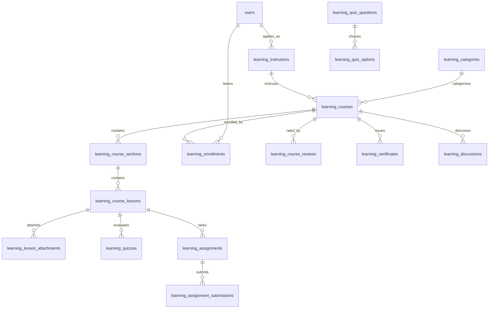

# PHASE 13: DATABASE DESIGN & SCHEMA SPECIFICATION
**Platform:** Connectly / JUGAJUG Enterprise Professional Social Networking Platform  
**System Module:** Professional Learning & Development Platform (LMS)  
**Date:** 2026-11-04  
**Author:** Lead Database Architect & Security Officer  

---

## 1. Relational Schema Architecture

The LMS database schema consists of 26 fully normalized tables featuring foreign key constraints, composite performance indexes, uniqueness guarantees, and audit fields.

---

## 2. Table Definitions & Specifications

### 2.1 Categories & Course Taxonomy
1. **`learning_categories`**
   - `id` (bigint, PK)
   - `parent_id` (bigint, nullable, FK -> learning_categories)
   - `name` (varchar 100)
   - `slug` (varchar 120, unique)
   - `icon` (varchar 255, nullable)
   - `description` (text, nullable)
   - `sort_order` (int, default 0)
   - `is_active` (boolean, default true)
   - `courses_count` (int, default 0)
   - `timestamps`

2. **`learning_courses`**
   - `id` (bigint, PK)
   - `instructor_id` (bigint, FK -> users)
   - `category_id` (bigint, nullable, FK -> learning_categories)
   - `title` (varchar 200)
   - `slug` (varchar 220, unique)
   - `subtitle` (varchar 300, nullable)
   - `description` (longText)
   - `level` (enum: 'all_levels', 'beginner', 'intermediate', 'expert', default 'all_levels')
   - `language` (varchar 30, default 'en')
   - `thumbnail_url` (varchar 500, nullable)
   - `promotional_video_url` (varchar 500, nullable)
   - `type` (enum: 'free', 'paid', 'private', 'organization', default 'free')
   - `price` (decimal 10,2, default 0.00)
   - `discounted_price` (decimal 10,2, nullable)
   - `currency` (varchar 10, default 'USD')
   - `status` (enum: 'draft', 'pending', 'published', 'suspended', 'archived', default 'draft')
   - `learning_objectives` (json, nullable)
   - `prerequisites` (json, nullable)
   - `target_audience` (json, nullable)
   - `duration_minutes` (int, default 0)
   - `total_sections` (int, default 0)
   - `total_lessons` (int, default 0)
   - `enrollments_count` (int, default 0)
   - `rating_avg` (decimal 3,2, default 0.00)
   - `rating_count` (int, default 0)
   - `is_featured` (boolean, default false)
   - `published_at` (datetime, nullable)
   - `timestamps`, `deleted_at`
   - *Indexes:* `instructor_id`, `category_id`, `status`, `type`, `price`, `rating_avg`, `is_featured`, composite(`status`, `category_id`, `published_at`).

3. **`learning_course_categories`**
   - `id` (bigint, PK)
   - `course_id` (bigint, FK -> learning_courses)
   - `category_id` (bigint, FK -> learning_categories)
   - `timestamps`
   - *Unique:* `(course_id, category_id)`

4. **`learning_course_skills`**
   - `id` (bigint, PK)
   - `course_id` (bigint, FK -> learning_courses)
   - `skill_name` (varchar 100)
   - `timestamps`
   - *Index:* `(course_id, skill_name)`

### 2.2 Sections & Lessons Curriculum
5. **`learning_course_sections`**
   - `id` (bigint, PK)
   - `course_id` (bigint, FK -> learning_courses)
   - `title` (varchar 200)
   - `description` (text, nullable)
   - `sort_order` (int, default 0)
   - `is_published` (boolean, default true)
   - `timestamps`
   - *Index:* `(course_id, sort_order)`

6. **`learning_course_lessons`**
   - `id` (bigint, PK)
   - `section_id` (bigint, FK -> learning_course_sections)
   - `course_id` (bigint, FK -> learning_courses)
   - `title` (varchar 200)
   - `slug` (varchar 220)
   - `type` (enum: 'video', 'article', 'quiz', 'assignment', 'resource', default 'video')
   - `content` (longText, nullable)
   - `video_url` (varchar 500, nullable)
   - `video_duration_seconds` (int, default 0)
   - `sort_order` (int, default 0)
   - `is_preview` (boolean, default false)
   - `is_mandatory` (boolean, default true)
   - `is_published` (boolean, default true)
   - `timestamps`
   - *Index:* `(course_id, section_id, sort_order)`

7. **`learning_lesson_attachments`**
   - `id` (bigint, PK)
   - `lesson_id` (bigint, FK -> learning_course_lessons)
   - `title` (varchar 200)
   - `file_url` (varchar 500)
   - `file_type` (varchar 50)
   - `file_size` (bigint, default 0)
   - `sort_order` (int, default 0)
   - `timestamps`

### 2.3 Instructors, Enrollments & Progress Tracking
8. **`learning_instructors`**
   - `id` (bigint, PK)
   - `user_id` (bigint, unique, FK -> users)
   - `headline` (varchar 255)
   - `biography` (text, nullable)
   - `expertise` (json, nullable)
   - `website_url` (varchar 255, nullable)
   - `linkedin_url` (varchar 255, nullable)
   - `github_url` (varchar 255, nullable)
   - `status` (enum: 'pending', 'approved', 'rejected', 'suspended', default 'pending')
   - `is_verified` (boolean, default false)
   - `commission_rate` (decimal 5,2, default 70.00)
   - `total_students` (int, default 0)
   - `total_courses` (int, default 0)
   - `rating_avg` (decimal 3,2, default 0.00)
   - `approved_at` (datetime, nullable)
   - `timestamps`

9. **`learning_enrollments`**
   - `id` (bigint, PK)
   - `course_id` (bigint, FK -> learning_courses)
   - `user_id` (bigint, FK -> users)
   - `status` (enum: 'active', 'completed', 'cancelled', 'refunded', default 'active')
   - `price_paid` (decimal 10,2, default 0.00)
   - `currency` (varchar 10, default 'USD')
   - `enrolled_at` (datetime)
   - `completed_at` (datetime, nullable)
   - `last_accessed_at` (datetime, nullable)
   - `timestamps`
   - *Unique:* `(course_id, user_id)`
   - *Indexes:* `user_id`, `status`

10. **`learning_lesson_progress`**
    - `id` (bigint, PK)
    - `enrollment_id` (bigint, FK -> learning_enrollments)
    - `course_id` (bigint, FK -> learning_courses)
    - `lesson_id` (bigint, FK -> learning_course_lessons)
    - `user_id` (bigint, FK -> users)
    - `is_completed` (boolean, default false)
    - `watch_time_seconds` (int, default 0)
    - `last_position_seconds` (int, default 0)
    - `completed_at` (datetime, nullable)
    - `timestamps`
    - *Unique:* `(user_id, lesson_id)`
    - *Indexes:* `(enrollment_id, is_completed)`

11. **`learning_course_progress`**
    - `id` (bigint, PK)
    - `enrollment_id` (bigint, unique, FK -> learning_enrollments)
    - `course_id` (bigint, FK -> learning_courses)
    - `user_id` (bigint, FK -> users)
    - `completed_lessons_count` (int, default 0)
    - `total_lessons_count` (int, default 0)
    - `percentage` (decimal 5,2, default 0.00)
    - `is_completed` (boolean, default false)
    - `completed_at` (datetime, nullable)
    - `timestamps`
    - *Unique:* `(user_id, course_id)`

### 2.4 Quizzes & Examinations
12. **`learning_quizzes`**
    - `id` (bigint, PK)
    - `lesson_id` (bigint, unique, FK -> learning_course_lessons)
    - `course_id` (bigint, FK -> learning_courses)
    - `title` (varchar 200)
    - `instructions` (text, nullable)
    - `time_limit_minutes` (int, default 0)
    - `passing_score` (int, default 70)
    - `max_attempts` (int, default 0)
    - `shuffle_questions` (boolean, default true)
    - `timestamps`

13. **`learning_quiz_questions`**
    - `id` (bigint, PK)
    - `quiz_id` (bigint, FK -> learning_quizzes)
    - `question` (text)
    - `type` (enum: 'multiple_choice', 'multiple_select', 'true_false', 'short_answer', default 'multiple_choice')
    - `points` (int, default 1)
    - `explanation` (text, nullable)
    - `sort_order` (int, default 0)
    - `timestamps`

14. **`learning_quiz_options`**
    - `id` (bigint, PK)
    - `question_id` (bigint, FK -> learning_quiz_questions)
    - `option_text` (text)
    - `is_correct` (boolean, default false)
    - `sort_order` (int, default 0)
    - `timestamps`

15. **`learning_quiz_attempts`**
    - `id` (bigint, PK)
    - `quiz_id` (bigint, FK -> learning_quizzes)
    - `user_id` (bigint, FK -> users)
    - `attempt_number` (int, default 1)
    - `score` (decimal 5,2, default 0.00)
    - `total_points` (int, default 0)
    - `earned_points` (int, default 0)
    - `passed` (boolean, default false)
    - `started_at` (datetime)
    - `submitted_at` (datetime, nullable)
    - `timestamps`
    - *Index:* `(quiz_id, user_id, attempt_number)`

16. **`learning_quiz_answers`**
    - `id` (bigint, PK)
    - `attempt_id` (bigint, FK -> learning_quiz_attempts)
    - `question_id` (bigint, FK -> learning_quiz_questions)
    - `selected_option_ids` (json, nullable)
    - `text_answer` (text, nullable)
    - `is_correct` (boolean, default false)
    - `points_awarded` (int, default 0)
    - `timestamps`

### 2.5 Assignments & Submissions
17. **`learning_assignments`**
    - `id` (bigint, PK)
    - `lesson_id` (bigint, unique, FK -> learning_course_lessons)
    - `course_id` (bigint, FK -> learning_courses)
    - `title` (varchar 200)
    - `instructions` (longText)
    - `max_score` (int, default 100)
    - `passing_score` (int, default 60)
    - `due_days_after_enrollment` (int, nullable)
    - `allow_resubmissions` (boolean, default true)
    - `timestamps`

18. **`learning_assignment_submissions`**
    - `id` (bigint, PK)
    - `assignment_id` (bigint, FK -> learning_assignments)
    - `user_id` (bigint, FK -> users)
    - `submission_text` (longText, nullable)
    - `file_url` (varchar 500, nullable)
    - `score` (int, nullable)
    - `feedback` (text, nullable)
    - `status` (enum: 'submitted', 'graded', 'resubmission_requested', default 'submitted')
    - `graded_by` (bigint, nullable, FK -> users)
    - `graded_at` (datetime, nullable)
    - `timestamps`
    - *Index:* `(assignment_id, user_id)`

### 2.6 Certifications, Reviews, Wishlists & Community
19. **`learning_certificates`**
    - `id` (bigint, PK)
    - `course_id` (bigint, FK -> learning_courses)
    - `user_id` (bigint, FK -> users)
    - `certificate_code` (varchar 64, unique)
    - `verification_token` (varchar 128, unique)
    - `student_name` (varchar 150)
    - `course_title` (varchar 200)
    - `instructor_name` (varchar 150)
    - `pdf_url` (varchar 500, nullable)
    - `qr_code_url` (varchar 500, nullable)
    - `issued_at` (datetime)
    - `is_revoked` (boolean, default false)
    - `revoked_reason` (varchar 255, nullable)
    - `timestamps`
    - *Unique:* `(course_id, user_id)`
    - *Index:* `certificate_code`

20. **`learning_course_reviews`**
    - `id` (bigint, PK)
    - `course_id` (bigint, FK -> learning_courses)
    - `user_id` (bigint, FK -> users)
    - `rating` (tinyint)
    - `content` (text, nullable)
    - `instructor_reply` (text, nullable)
    - `replied_at` (datetime, nullable)
    - `helpful_votes` (int, default 0)
    - `is_approved` (boolean, default true)
    - `timestamps`
    - *Unique:* `(course_id, user_id)`

21. **`learning_wishlists`**
    - `id` (bigint, PK)
    - `user_id` (bigint, FK -> users)
    - `course_id` (bigint, FK -> learning_courses)
    - `timestamps`
    - *Unique:* `(user_id, course_id)`

22. **`learning_discussions`**
    - `id` (bigint, PK)
    - `course_id` (bigint, FK -> learning_courses)
    - `lesson_id` (bigint, nullable, FK -> learning_course_lessons)
    - `user_id` (bigint, FK -> users)
    - `title` (varchar 200)
    - `content` (text)
    - `replies_count` (int, default 0)
    - `is_pinned` (boolean, default false)
    - `is_locked` (boolean, default false)
    - `timestamps`
    - *Index:* `(course_id, lesson_id)`

23. **`learning_discussion_replies`**
    - `id` (bigint, PK)
    - `discussion_id` (bigint, FK -> learning_discussions)
    - `user_id` (bigint, FK -> users)
    - `content` (text)
    - `is_instructor_reply` (boolean, default false)
    - `is_solution` (boolean, default false)
    - `timestamps`
    - *Index:* `(discussion_id)`

24. **`learning_course_announcements`**
    - `id` (bigint, PK)
    - `course_id` (bigint, FK -> learning_courses)
    - `instructor_id` (bigint, FK -> users)
    - `title` (varchar 200)
    - `content` (text)
    - `timestamps`
    - *Index:* `(course_id)`

25. **`learning_course_coupons`**
    - `id` (bigint, PK)
    - `course_id` (bigint, nullable, FK -> learning_courses)
    - `code` (varchar 50, unique)
    - `discount_type` (enum: 'percentage', 'fixed', default 'percentage')
    - `discount_amount` (decimal 10,2)
    - `max_uses` (int, default 0)
    - `times_used` (int, default 0)
    - `expires_at` (datetime, nullable)
    - `is_active` (boolean, default true)
    - `timestamps`

26. **`learning_transactions`**
    - `id` (bigint, PK)
    - `enrollment_id` (bigint, nullable, FK -> learning_enrollments)
    - `course_id` (bigint, FK -> learning_courses)
    - `user_id` (bigint, FK -> users)
    - `instructor_id` (bigint, FK -> users)
    - `amount` (decimal 10,2)
    - `instructor_earning` (decimal 10,2)
    - `platform_fee` (decimal 10,2)
    - `currency` (varchar 10, default 'USD')
    - `payment_method` (varchar 50, default 'wallet')
    - `transaction_reference` (varchar 100, unique)
    - `status` (enum: 'pending', 'completed', 'refunded', 'failed', default 'completed')
    - `idempotency_key` (varchar 100, unique, nullable)
    - `timestamps`
    - *Index:* `(user_id, course_id, status)`

