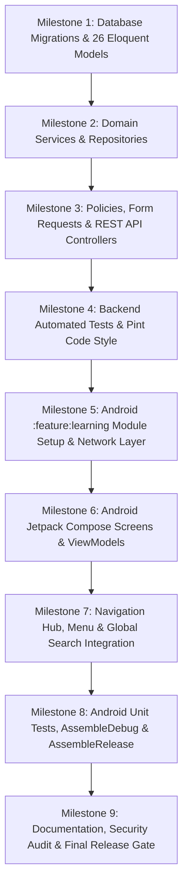

# PHASE 13: STEP-BY-STEP IMPLEMENTATION PLAN
**Platform:** Connectly / JUGAJUG Enterprise Professional Social Networking Platform  
**System Module:** Professional Learning & Development Platform (LMS)  
**Date:** 2026-11-04  
**Author:** Senior Software Architect & Lead Release Manager  

---

## 1. Execution Roadmap & Milestones

This plan specifies the exact execution order to guarantee backward compatibility with Phase 01–12 and zero regression.

---

## 2. Milestone Breakdown

### Milestone 1: Database Migrations & Models
- Implement 8 database migrations covering all 26 normalized tables.
- Run `php artisan migrate` and verify zero errors.
- Create 26 Eloquent models in `app/Models/` with relationships, attribute casts, scopes, and helper methods.

### Milestone 2: Backend Domain Services & Repositories
- `CourseService`: Course CRUD, category aggregation, publishing workflows, search filtering.
- `CourseContentService`: Section and lesson manipulation, reordering, attachments.
- `InstructorService`: Instructor applications, approval, public profile, verification badges.
- `EnrollmentService`: Free and paid course enrollment, duplicate prevention, transactions.
- `LearningProgressService`: Timestamp tracking, 80% completion rule, course percent recalculation.
- `QuizService`: Quiz setup, attempts limit check, question delivery without answers, server-side grading.
- `AssignmentService`: Instructions, deadline checks, student submissions, instructor grading.
- `CertificateService`: Completion eligibility validation, unique code generation (`CERT-YYYY-XXXX-XXXX`), public verification token, sync with `CandidateCertification`.
- `CourseReviewService`: Enrolled student verification, star rating recalculation.

### Milestone 3: Policies, Form Requests & REST API Controllers
- Implement Policies: `LearningCoursePolicy`, `LearningLessonPolicy`, `LearningQuizPolicy`, `LearningAssignmentPolicy`.
- Implement Form Requests: `StoreCourseRequest`, `SubmitQuizAttemptRequest`, `SubmitAssignmentRequest`, `StoreCourseReviewRequest`.
- Implement API Controllers under `app/Http/Controllers/Api/v1/Learning/`.
- Register routes in `routes/api.php` under prefix `/api/v1/learning/`.

### Milestone 4: Backend Automated Tests & Pint Code Style
- Create comprehensive PHPUnit feature test suite `tests/Feature/Phase13CompleteLmsSystemTest.php`.
- Test course creation, curriculum, enrollment, lesson streaming policy, quiz attempt & grading, certificate issuance, and review authorization.
- Format with `vendor/bin/pint`.

### Milestone 5: Android `:feature:learning` Module Setup & Network Layer
- Register `:feature:learning` in `android/settings.gradle.kts`.
- Configure `android/feature/learning/build.gradle.kts`.
- Add learning endpoints and DTOs to `ConnectlyApi.kt`.
- Implement Domain Models, `LearningRepository`, and `LearningRepositoryImpl`.

### Milestone 6: Android Jetpack Compose Presentation Layer
- Implement `LearningHomeScreen`, `CourseDiscoveryScreen`, `CourseDetailsScreen`, `VideoLearningScreen` (with ExoPlayer), `QuizScreen`, `AssignmentScreen`, `CertificateScreen`, and `InstructorDashboardScreen`.
- ViewModels with reactive StateFlow MVI pattern.

### Milestone 7: Navigation & Ecosystem Integration
- Wire `:feature:learning` navigation routes (`LearningNavigation.kt`) into `MainActivity.kt`.
- Add "Learning & Courses" service card into `MenuScreen.kt`.
- Extend `GlobalSearchRequest` and `SearchService` to support courses.

### Milestone 8: Android Automated Tests & Build Verification
- Unit test ViewModels with Turbine and MockK (`LearningViewModelTest.kt`).
- Run `./gradlew :feature:learning:test`.
- Run `./gradlew assembleDebug` and `./gradlew assembleRelease`.

### Milestone 9: Documentation & Release Gate
- Generate audit, security, performance, test, and release documentation.
- Verify all release criteria.

