# Phase 13: LMS Implementation Roadmap & Staging Plan
**Platform:** Connectly / JUGAJUG Enterprise Professional Social Networking Platform  
**System Module:** Professional Learning & Development Platform (LMS)  
**Date:** November 2026  
**Status:** STAGE 01 COMPLETE — READY FOR STAGE 02  

---

## 1. Stage-by-Stage Implementation Roadmap

```mermaid
flowchart LR
    S1["Stage 01<br/>Baseline Audit & Discovery"] --> S2["Stage 02<br/>Architecture & Schema Finalization"]
    S2 --> S3["Stage 03<br/>Course Marketplace & Catalog"]
    S3 --> S4["Stage 04<br/>Instructor Hub & Course Wizard"]
    S4 --> S5["Stage 05<br/>Enrollment & Video Player"]
    S5 --> S6["Stage 06<br/>Quiz & Assignment Engine"]
    S6 --> S7["Stage 07<br/>Certificate & Verification"]
    S7 --> S8["Stage 08<br/>Reviews, Q&A & Community"]
    S8 --> S9["Stage 09<br/>Android Screens Integration"]
    S9 --> S10["Stage 10<br/>Payment, Analytics & Admin"]
    S10 --> S11["Stage 11<br/>Security & Extreme Regression"]
    S11 --> S12["Stage 12<br/>Final Release Gate (GO/NO-GO)"]
```

---

## 2. Stage Breakdown & Acceptance Gates

### Stage 01: Baseline Audit & Existing Feature Discovery (COMPLETED)
* Inspect existing Phase 12.1 reports, database schema, media pipeline, payment system, and Android modules.
* Document reusable platform subsystems and discovered LMS foundations.
* Deliverables:
  - `PHASE_13_BASELINE_AUDIT.md`
  - `PHASE_13_EXISTING_FEATURE_DISCOVERY.md`
  - `PHASE_13_ARCHITECTURE_PLAN.md`
  - `PHASE_13_DATABASE_DESIGN.md`
  - `PHASE_13_API_DESIGN.md`
  - `PHASE_13_IMPLEMENTATION_ROADMAP.md`
* Acceptance Gate: Read-only audit passed with zero code mutations and baseline locked.

### Stage 02: Architecture, Database & API Design Finalization
* Verify that all 26 LMS tables have exact column types, indexes, and foreign keys.
* Finalize REST API endpoints, request validation rules, and response DTO schemas.
* Ensure backward compatibility with existing tables (`users`, `media`, `job_skills`, `candidate_certifications`).

### Stage 03: Backend LMS Foundation & Course Marketplace
* Implement / verify `CourseService` and `CourseContentService`.
* Category tree retrieval with active course counts.
* Course search, skill-based filtering, level sorting, and pagination.
* Course details endpoint with syllabus preview, instructor summary, and enrollment status.

### Stage 04: Instructor System & Course Creation Wizard
* Instructor application submission and admin verification workflow.
* Instructor dashboard: course listings, student counts, and rating metrics.
* Course creation & editing wizard: metadata, pricing, thumbnail, sections, and lessons.
* Course lifecycle management: Draft -> Pending Review -> Published -> Archived.

### Stage 05: Enrollment & Secure Video Learning
* Free course enrollment with unique user/course constraint.
* Paid course enrollment via existing wallet and transaction architecture.
* Access-controlled lesson streaming URLs (ExoPlayer compatible).
* Real-time progress synchronization (`updateProgress`) and dynamic course completion calculation.

### Stage 06: Quiz, Examination & Assignment Subsystem
* Quiz authoring: multiple-choice, multi-select, and true/false questions.
* Timed quiz attempts with automatic server-side scoring. Answer masking on client payloads.
* Assignment authoring, submission with text/file attachments, and instructor grading with feedback.

### Stage 07: Certificate & Public Verification Subsystem
* Eligibility verification rule engine: 100% lesson completion and passing quiz scores.
* Cryptographic certificate code generation (`CERT-YYYY-XXXX-XXXX`).
* PDF certificate generator with embedded QR code.
* Public verification endpoint (`/api/v1/learning/certificates/{code}`) and auto-link to candidate profile achievements.

### Stage 08: Reviews, Q&A Discussions & Real-Time Notifications
* Course reviews: 1–5 star ratings and verified enrollment badge.
* Course Q&A discussion threads with instructor replies and resolution marking.
* Event notifications for enrollment, certificate issuance, and discussion replies.

### Stage 09: Android LMS UI & Clean Architecture Integration
* Complete Android screens in `:feature:learning`:
  1. `LearningHomeScreen` (Discover, My Learning, Certificates)
  2. `CourseDetailsScreen`
  3. `VideoLearningScreen` (ExoPlayer integration)
  4. `QuizScreen` & `QuizResultScreen`
  5. `AssignmentScreen` & `SubmissionScreen`
  6. `InstructorDashboardScreen` & `CourseCreationScreen`
* Integration with app navigation in `MainActivity.kt` and `MenuScreen.kt`.

### Stage 10: Payment, Analytics & Admin Moderation
* Wallet and payment gateway checkout for paid courses.
* Student, instructor, and platform learning analytics dashboards.
* Admin moderation tools for courses, instructor applications, and reported content.

### Stage 11: Security, Performance & Platform-Wide Regression
* Security audit: IDOR protection, CSRF, signed URLs, answer leakage prevention, and SQL injection defense.
* Performance audit: query eager loading, indexing validation, and Android recomposition optimization.
* Execution of complete Laravel and Android test suites.

### Stage 12: Final Release Gate
* Execution of full release checklist: Pint, backend tests, Android unit tests, `assembleDebug`, and `assembleRelease`.
* Comprehensive GO / NO-GO certification report.

