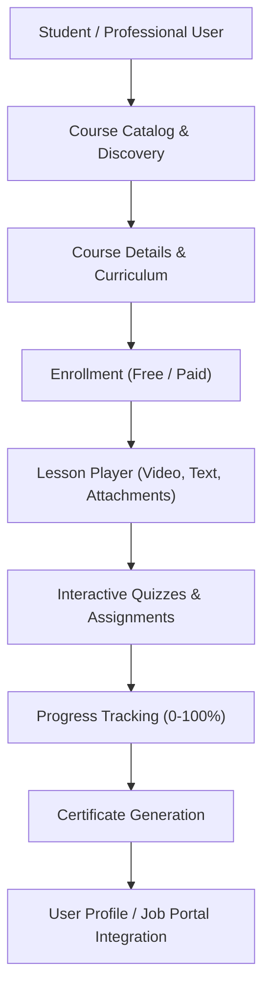

# Phase 13: LMS Integration Readiness & Component Reuse Analysis
**Application:** Connectly / JUGAJUG  
**Component:** Professional Learning & Development Platform (LMS)  
**Readiness Level:** HIGH (Architecture & Subsystems Ready)  

---

## 1. Objective

To prevent duplicate code, unnecessary tables, and disjointed user experiences, this audit evaluates how the Phase 13 LMS will integrate with existing Connectly / JUGAJUG platform infrastructure.

---

## 2. Component Reuse Matrix

| LMS Requirement | Existing Platform Component to Reuse | Integration Strategy |
|---|---|---|
| **User Identity & Roles** | `users`, `roles`, `permissions` tables; Sanctum authentication | Instructors, Students, and Reviewers reuse existing `User` identity without separate login tables. Role middleware (`RoleMiddleware`, `PermissionMiddleware`) protects instructor/admin actions. |
| **Instructor Profiles** | `CandidateProfile`, `CandidateCertification` | Links instructor credentials directly to existing verified candidate skills and portfolio items. |
| **Course Skills Taxonomy** | `job_skills` and `job_categories` tables | Reuse the standardized skill taxonomy (`JobSkill`, `JobCategory`) so courses directly tag skills in demand by the Job Portal. |
| **Media & Video Streaming** | `media` storage service (`Storage::disk('public')`) and Reels/Post media pipeline | Reuse established upload endpoints, thumbnail generators, and HLS/MP4 video storage for course lessons and promo videos. |
| **Course Discussion Communities** | Group subsystem (`groups`, `group_members`, `group_posts`, `comments`) | Course discussion forums can leverage the existing Group architecture or dedicated lightweight `LearningDiscussion` threads integrated with user avatars. |
| **Notifications & Reminders** | Laravel Notifications + FCM (`fcm_device_tokens`) + Reverb WebSockets | Automatic notifications for quiz grading, course announcements, enrollment confirmations, and certificate awards via the established Notification subsystem. |
| **Certificates & Achievements** | User Profile Achievements (`ProfileEnterpriseApiController`) | Generated certificates automatically attach to the candidate's professional profile and become visible to recruiters in the Job Portal / ATS. |
| **Monetization & Purchases** | Escrow / Marketplace commerce (`Phase5MarketplaceAndEscrowCommerceTest`) | Course payment workflows reuse the existing escrow transaction structure (`LearningTransaction`) with support for discount coupons. |

---

## 3. LMS Architecture Blueprint

---

## 4. Integration Verdict
The platform contains all required building blocks. The LMS feature set will enrich the existing Connectly ecosystem without causing fragmentation or redundancy.

