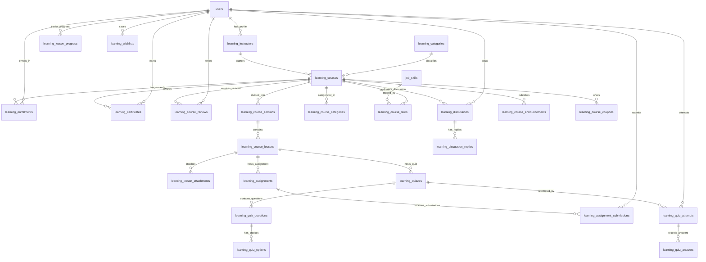

# Phase 13 — Stage 02: LMS Entity Relationship Diagram (ERD)
**Project:** Connectly / JUGAJUG Enterprise Professional Social Networking Platform  
**Stage:** 02 — LMS Database, Backend Architecture & API Foundation  
**Date:** November 2026  
**Author:** Principal Software Architect & Lead Database Architect  

---

## 1. High-Level Subsystem Architecture

---

## 2. Cardinality & Relationship Constraints

| Parent Table | Child Table | Relationship | Foreign Key | Cascade Behavior | Business Invariant |
|---|---|---|---|---|---|
| `users` | `learning_instructors` | 1 to 1 (optional) | `user_id` | CASCADE | An instructor is an extended profile of a verified user. |
| `users` | `learning_enrollments` | 1 to Many | `user_id` | CASCADE | A student can enroll in multiple courses. Compound unique on `(user_id, course_id)` prevents double enrollment. |
| `learning_courses` | `learning_course_sections` | 1 to Many | `course_id` | CASCADE | Sections organize the course syllabus in deterministic `sort_order`. |
| `learning_course_sections` | `learning_course_lessons` | 1 to Many | `section_id` | CASCADE | Lessons are ordered units of video, text, quiz, or assignment content. |
| `learning_courses` | `learning_course_skills` | 1 to Many | `course_id` | CASCADE | Links course directly to existing `job_skills` from Job Portal / ATS. |
| `learning_course_lessons` | `learning_quizzes` | 1 to 1 | `lesson_id` | CASCADE | Evaluative quizzes tied to specific lessons. |
| `learning_quizzes` | `learning_quiz_questions` | 1 to Many | `quiz_id` | CASCADE | Questions in single-choice, multi-choice, or true/false format. |
| `learning_quiz_questions` | `learning_quiz_options` | 1 to Many | `question_id` | CASCADE | Options store `is_correct` on backend; hidden from student requests. |
| `learning_courses` | `learning_certificates` | 1 to Many | `course_id` | CASCADE | Certificates issued upon 100% completion with unique cryptographic `certificate_code`. |
| `learning_courses` | `learning_course_reviews` | 1 to Many | `course_id` | CASCADE | Enrolled students submit 1 review per course (`UNIQUE KEY (user_id, course_id)`). |

