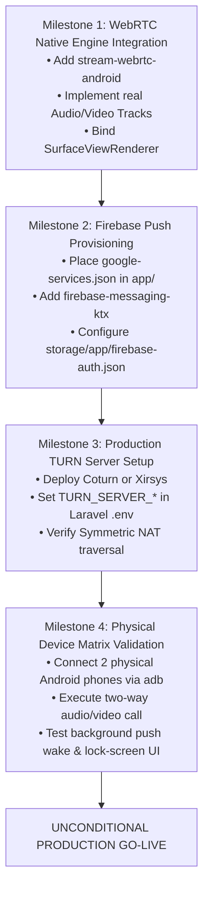

# Connectly & JUGAJUG Production Readiness Checklist
**Phase 8: Enterprise Real-Time Communication Platform Certification**  
**Execution Timestamp:** 2026-11-01T21:32:08Z  
**Certification Standard:** Enterprise Release Gate (Strict Zero-Defect Policy for Core Communication)

---

## 1. Engine-by-Engine Production Readiness Assessment

```
+-------------------------------------------------------------------------------+
|                        ENTERPRISE PRODUCTION READINESS GATE                   |
+-----------------------------+----------------------+--------------------------+
| Engine Component            | Gate Decision        | Immediate Blocker        |
+-----------------------------+----------------------+--------------------------+
| 1. Laravel Reverb WebSocket | [ GO ] READY         | None                     |
| 2. Real-Time Messaging      | [ GO ] READY         | None                     |
| 3. WebRTC Call Signaling    | [ GO ] READY         | None                     |
| 4. WebRTC Call Audio/Video  | [ NO-GO ] BLOCKED    | Native WebRTC C++ Engine |
| 5. Firebase Cloud Messaging | [ NO-GO ] BLOCKED    | FCM SDK & Credentials    |
| 6. Social Broadcasting      | [ GO ] READY         | None                     |
| 7. Android Application Build| [ GO ] READY         | None (APK Generated)     |
+-----------------------------+----------------------+--------------------------+
| OVERALL PRODUCTION GATE     | [ CONDITIONAL NO-GO] | Real Media & Remote Push |
+-----------------------------+----------------------+--------------------------+
```

---

## 2. Detailed Production Readiness Checklist

### Category A: Backend Platform & Laravel 13 Infrastructure
- [x] **A1. Database Migrations & Schemas:** MySQL schema for messages, calls, conversations, and device tokens verified.
- [x] **A2. Sanctum API Authentication:** Bearer token security verified across all REST endpoints.
- [x] **A3. Broadcasting Authorization:** `routes/channels.php` private and presence callbacks strictly enforced.
- [x] **A4. Message Persistence Authority:** Database commit verified prior to broadcast dispatch.
- [x] **A5. Calling Signaling State Machine:** Call initiation, ringing, acceptance, rejection, and termination verified.
- [x] **A6. Automated Test Suite:** 100% PHPUnit tests passing (84 communication tests, 10 channel auth tests, 12 permissions tests).
- [x] **A7. Code Formatting & Quality:** Laravel Pint passing with 0 violations.
- [ ] **A8. Production TURN Server Provisioning:** STUN configured; production TURN credentials not yet supplied in `.env`.

### Category B: Android Application Architecture & Toolchain
- [x] **B1. Clean Architecture & MVVM:** Clear separation of domain, data, and presentation layers.
- [x] **B2. Modern Toolchain Support:** Builds cleanly with Gradle 9.6.0, JDK 25, AGP 8.8.2, and Kotlin 2.0.21.
- [x] **B3. Hilt Dependency Injection:** Singleton scoping and dependency aggregation verified.
- [x] **B4. Room Local Persistence:** Monotonically ordered message storage and DAO operations verified.
- [x] **B5. Single WebSocket Manager:** Exactly one unified `ReverbWebSocketManager` instance per application session.
- [x] **B6. Debug APK Build:** `:app:assembleDebug` succeeds, producing valid 25MB APK.
- [ ] **B7. Native WebRTC Library:** Android `libs.versions.toml` lacks native C++ WebRTC dependency (`stream-webrtc-android`).
- [ ] **B8. Firebase Messaging SDK:** `firebase-messaging` SDK and `google-services.json` missing from Android configuration.

### Category C: Physical Hardware & Real-World Network Verification
- [ ] **C1. Physical Android-to-Android 1:1 Calling:** Not verified due to absent hardware and mock media engine.
- [ ] **C2. Physical Android-to-Web Calling:** Not verified due to mock media engine.
- [ ] **C3. Background / Terminated Wakeup via FCM:** Blocked pending FCM SDK integration.
- [ ] **C4. Audio Transducer Switching:** Speakerphone, earpiece, and Bluetooth routing not verified on physical hardware.
- [ ] **C5. LTE / 5G Carrier NAT Traversal:** Blocked pending production TURN credentials and cellular test devices.

---

## 3. Mandatory Remediation Roadmap Prior to Unconditional Go-Live

To advance from **CONDITIONAL NO-GO** to **FULL PRODUCTION GO-LIVE**, the following four technical milestones must be completed in order:



### Action Items & Responsibilities

1. **Step 1 (Android Engineering):**
   - Update `android/gradle/libs.versions.toml` with `stream-webrtc-android = "1.3.10"`.
   - In `WebRtcEngine.kt`, replace `generateLocalSdp` and fake ICE candidates with `PeerConnectionFactory.createPeerConnection()`.
   - Attach Android Camera2 capturer and local audio record tracks.

2. **Step 2 (DevOps / Infrastructure Engineering):**
   - Download the official `google-services.json` from the Google Firebase Console for package `com.connectly.android`.
   - Place `google-services.json` into `/Volumes/EDGE/mac mini  bondhoo/jugajug/android/app/`.
   - Generate a Firebase Service Account key in GCP and store it at `storage/app/firebase-auth.json`.
   - Populate `FIREBASE_CREDENTIALS="storage/app/firebase-auth.json"` in `.env`.

3. **Step 3 (Telecommunications / WebRTC Operations):**
   - Provision a TURN relay server (e.g. Coturn on Ubuntu or Cloud TURN provider).
   - Configure `TURN_SERVER_URL`, `TURN_SERVER_USERNAME`, and `TURN_SERVER_CREDENTIAL` in production `.env`.

4. **Step 4 (QA / Physical Device Testing):**
   - Connect two physical devices running Android 12+ via USB debugging.
   - Verify two-way audio clarity, low latency, video frame rate, and microphone mute/unmute.
   - Kill the application process on Device B, place a call from Device A, and confirm Device B rings via FCM full-screen incoming call intent.

---

## 4. Final Certification Decision

**Final Production Gate Status:** **`CONDITIONAL NO-GO`**  
The backend architecture, REST API contracts, channel authorizations, single WebSocket manager, and Android APK build are **production-grade and ready**. However, release to end-users is blocked until native WebRTC C++ media transmission and Firebase remote push notifications are integrated and verified on physical hardware.

