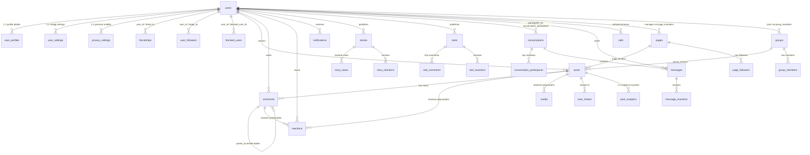

# Database Schema & Data Architecture Specification

## 1. Overview & Architectural Principles

The database design for **Bondhoo (Jugajug)** is structured to support high-frequency reads, concurrent social graph interactions, and ACID transactional integrity across a modular schema of **155+ tables** managed through **88 migrations**.

### Design Principles:
1. **Third Normal Form (3NF)**: Core transactional entities are normalized to prevent update anomalies.
2. **Selective Denormalization & Counter Caches**: High-frequency counters (`likes_count`, `comments_count`, `shares_count`, `friends_count`, `followers_count`) are maintained directly on parent models and synchronized via atomic DB triggers or domain events.
3. **Cursor-Based Pagination Readiness**: Timelines and message feeds use monotonic primary keys and timestamp indexes (`(is_pinned DESC, id DESC)` or `(created_at DESC, id DESC)`) instead of slow `OFFSET` pagination.
4. **Polymorphic Media & Reactions**: Media attachments (`media`) and social reactions (`reactions`) use polymorphic relations (`mediable_type`, `mediable_id`, `reactable_type`, `reactable_id`) to attach to Posts, Comments, Stories, and Reels without table duplication.
5. **Auditing & Defensive Soft-Deletes**: Critical user-generated content and financial records implement soft deletes (`deleted_at`) and audit logs for regulatory compliance and dispute resolution.

---

## 2. Entity-Relationship Diagram (ERD)



---

## 3. Core Domain Clusters

The 155+ tables are divided into 8 distinct functional clusters:

### 3.1 Cluster A: Identity, Authentication & Security
Manages credential verification, session states, and device security.

| Table Name | Description | Key Columns & Indexes |
| :--- | :--- | :--- |
| `users` | Primary user identity & credentials | `id`, `name`, `username` (UNIQUE), `email` (UNIQUE), `phone` (UNIQUE), `password`, `status`, `two_factor_enabled`, `last_login_at` |
| `user_profiles` | Extended biographical data | `user_id` (FK, UNIQUE), `avatar_url`, `cover_image_url`, `bio`, `headline`, `website`, `location`, `gender`, `birth_date` |
| `user_settings` | App preferences & themes | `user_id` (FK, UNIQUE), `theme`, `language`, `email_notifications`, `push_notifications`, `messenger_sound` |
| `privacy_settings`| Granular visibility rules | `user_id` (FK, UNIQUE), `profile_visibility`, `post_default_privacy`, `friend_list_visibility`, `allow_tagging` |
| `admins` | Elevated backoffice administrators | `id`, `name`, `email` (UNIQUE), `password`, `role`, `status` |
| `device_sessions` | Multi-device active tokens | `user_id` (FK), `device_id`, `ip_address`, `user_agent`, `last_active_at`, `is_current` |
| `login_histories` | Audit trail of logins | `user_id` (FK), `ip_address`, `device_type`, `location`, `status`, `created_at` |
| `trusted_devices` | Recognized 2FA hardware devices | `user_id` (FK), `device_fingerprint`, `verified_at`, `expires_at` |
| `user_two_factor` | TOTP secrets & configs | `user_id` (FK, UNIQUE), `secret` (ENCRYPTED), `confirmed_at` |
| `recovery_codes` | Single-use emergency backup codes | `user_id` (FK), `code_hash`, `used_at` |
| `roles` & `permissions` | Spatie-style RBAC system | `name`, `guard_name`, `role_user`, `permission_role` |

### 3.2 Cluster B: Social Graph & Relationships
Handles friendships, follows, blocks, and custom lists.

| Table Name | Description | Key Columns & Indexes |
| :--- | :--- | :--- |
| `friendships` | Bidirectional connection states | `id`, `user_id` (FK), `friend_id` (FK), `status` (`pending`, `accepted`, `declined`, `blocked`), `requested_at`, `accepted_at`. Unique index on `(user_id, friend_id)`. |
| `user_followers` | Asymmetric follow graph | `user_id` (FK), `target_id` (FK), `created_at`. Unique index on `(user_id, target_id)`. |
| `blocked_users` | Explicit user blacklists | `user_id` (FK), `blocked_user_id` (FK), `reason`, `created_at`. |
| `friend_lists` | Custom user-defined friend groups | `user_id` (FK), `name`, `type` (`close_friends`, `acquaintances`, `custom`). |
| `friend_list_members` | Pivot table for friend lists | `friend_list_id` (FK), `friend_id` (FK). |

### 3.3 Cluster C: Content Engine (Posts, Comments, Reactions, Media)
The core user-generated content backbone.

| Table Name | Description | Key Columns & Indexes |
| :--- | :--- | :--- |
| `posts` | Feed posts, status updates | `id`, `user_id` (FK), `group_id` (FK nullable), `page_id` (FK nullable), `content` (TEXT), `audience` (`public`, `friends`, `only_me`), `is_pinned`, `likes_count`, `comments_count`, `shares_count`, `scheduled_at`, `status`. Indexes: `(user_id, created_at)`, `(is_pinned, id)`. |
| `comments` | Threaded discussions on posts | `id`, `post_id` (FK), `user_id` (FK), `parent_id` (FK nullable for nested replies), `body` (TEXT), `likes_count`, `replies_count`, `deleted_at`. Index: `(post_id, parent_id, id)`. |
| `reactions` | Polymorphic emotion reactions | `id`, `user_id` (FK), `reactable_type`, `reactable_id`, `type` (`like`, `love`, `care`, `haha`, `wow`, `sad`, `angry`). Unique index: `(user_id, reactable_type, reactable_id)`. |
| `media` | Polymorphic file attachments | `id`, `mediable_type`, `mediable_id`, `original_path`, `thumbnail_path`, `disk`, `mime_type`, `size_bytes`, `width`, `height`, `duration_seconds`. |
| `post_drafts` | Unfinished auto-saved drafts | `user_id` (FK), `content`, `media_meta`, `saved_at`. |
| `post_shares` | Resharing tracking | `post_id` (FK), `user_id` (FK), `caption`, `created_at`. |
| `post_analytics` | High-frequency telemetry | `post_id` (FK, UNIQUE), `impressions`, `reach`, `engagement_rate`, `clicks`. |
| `saved_items` | User bookmarks | `user_id` (FK), `item_type`, `item_id`, `created_at`. |

### 3.4 Cluster D: Ephemeral & Short-Form Video (Stories & Reels)
High-engagement 24-hour stories and vertical reels.

| Table Name | Description | Key Columns & Indexes |
| :--- | :--- | :--- |
| `stories` | 24-hour ephemeral stories | `id`, `user_id` (FK), `media_id` (FK), `caption`, `views_count`, `expires_at`, `is_highlight`. Index: `(user_id, expires_at)`. |
| `story_views` | Unique viewers per story | `story_id` (FK), `viewer_id` (FK), `viewed_at`. Unique index: `(story_id, viewer_id)`. |
| `story_highlights` | Permanent curated story collections | `user_id` (FK), `title`, `cover_image_url`. |
| `reels` | Short vertical video posts | `id`, `user_id` (FK), `music_track_id` (FK nullable), `video_path`, `thumbnail_path`, `views_count`, `likes_count`, `comments_count`. |
| `music_tracks` | Licensed audio for Reels & Stories | `id`, `title`, `artist`, `audio_path`, `duration`, `usage_count`. |

### 3.5 Cluster E: Communities (Pages & Groups)
Enterprise business pages and community groups.

| Table Name | Description | Key Columns & Indexes |
| :--- | :--- | :--- |
| `pages` | Brand and business profiles | `id`, `user_id` (Owner FK), `name`, `slug` (UNIQUE), `category_id`, `followers_count`, `is_verified`, `status`. |
| `page_members` | Staff and roles (Admin, Editor) | `page_id` (FK), `user_id` (FK), `role` (`admin`, `editor`, `moderator`). |
| `page_followers` | Page follower graph | `page_id` (FK), `user_id` (FK). Unique: `(page_id, user_id)`. |
| `groups` | Interest communities | `id`, `user_id` (Creator FK), `name`, `privacy` (`public`, `private`, `secret`), `members_count`, `rules_count`. |
| `group_members` | Group membership with role | `group_id` (FK), `user_id` (FK), `role` (`admin`, `moderator`, `member`), `status` (`active`, `pending`, `banned`). |
| `group_discussions`| Forum-style discussion threads | `group_id` (FK), `user_id` (FK), `title`, `content`, `replies_count`. |

### 3.6 Cluster F: Real-Time Messaging & Calling
Encrypted peer-to-peer and group communications.

| Table Name | Description | Key Columns & Indexes |
| :--- | :--- | :--- |
| `conversations` | Chat channels (1-to-1 and group) | `id`, `type` (`direct`, `group`), `title`, `last_message_at`, `created_at`. |
| `conversation_participants` | Membership & mute states | `conversation_id` (FK), `user_id` (FK), `role`, `last_read_message_id`, `is_muted`. Unique: `(conversation_id, user_id)`. |
| `messages` | Chat messages | `id`, `conversation_id` (FK), `user_id` (FK), `body` (TEXT), `type` (`text`, `image`, `video`, `audio`, `system`), `version`, `is_tombstone`, `created_at`. Index: `(conversation_id, id)`. |
| `message_reactions` | Emojis on chat messages | `message_id` (FK), `user_id` (FK), `emoji`. Unique: `(message_id, user_id)`. |
| `calls` | WebRTC audio/video call sessions | `id`, `conversation_id` (FK), `caller_id` (FK), `type` (`audio`, `video`), `status` (`ringing`, `connected`, `ended`, `missed`), `started_at`, `ended_at`. |
| `notifications` | Database notification logs | `id` (UUID, PRIMARY), `type`, `notifiable_type`, `notifiable_id`, `data` (JSON), `read_at`, `created_at`. Index: `(notifiable_type, notifiable_id, read_at)`. |

### 3.7 Cluster G: Marketplace & Monetization
E-commerce, ads, and digital creator monetization.

| Table Name | Description | Key Columns & Indexes |
| :--- | :--- | :--- |
| `marketplace_products` | Classified listings | `id`, `user_id` (FK), `category_id`, `title`, `price`, `currency`, `location`, `status` (`active`, `sold`). |
| `wallets` | Digital balances & credits | `id`, `user_id` (FK, UNIQUE), `balance`, `currency`, `is_frozen`. |
| `ad_campaigns` | Promoted post campaigns | `id`, `user_id` (FK), `post_id` (FK), `budget`, `spent`, `impressions`, `clicks`, `status`. |

### 3.8 Cluster H: AI & Vector Embeddings
Semantic search and AI-assisted content features.

| Table Name | Description | Key Columns & Indexes |
| :--- | :--- | :--- |
| `ai_prompts` | Prompt templates & configs | `id`, `name`, `model`, `system_prompt`, `parameters` (JSON). |
| `vector_embeddings` | Semantic embeddings for search | `id`, `em_type` (Post, User), `em_id`, `embedding` (TEXT / VECTOR), `updated_at`. |

---

## 4. High-Scale Indexing & Query Optimization Patterns

1. **Feed Cursor Index**:
   ```sql
   CREATE INDEX posts_feed_cursor_idx ON posts (is_pinned DESC, id DESC);
   CREATE INDEX posts_audience_created_idx ON posts (audience, created_at DESC);
   ```
   Ensures that `FeedService::getFeed()` executes without memory-intensive filesorts.

2. **Social Graph Symmetry**:
   Bidirectional friendship checks utilize the composite index:
   ```sql
   CREATE UNIQUE INDEX friendships_pair_idx ON friendships (user_id, friend_id);
   ```

3. **Message Pagination**:
   Messages within a chat room are retrieved via a clustered index pattern:
   ```sql
   CREATE INDEX messages_conv_id_idx ON messages (conversation_id, id DESC);
   ```

4. **Polymorphic Reaction Uniqueness**:
   Prevents duplicate reactions per user on any reactable target:
   ```sql
   CREATE UNIQUE INDEX reactions_user_reactable_idx ON reactions (user_id, reactable_type, reactable_id);
   ```

---

## 5. Schema Maintenance & Scaling Strategy

- **Historical Partitioning**: High-growth tables (`notifications`, `login_histories`, `audit_logs`) should be partitioned monthly by `created_at` once row counts exceed 10 million.
- **Foreign Key Cascade Prudence**: Deleting a user must never trigger an uncontrolled cascade across millions of comments and reactions. Soft deletion (`users.deleted_at`) is enforced to preserve data integrity and thread readability.
- **Database Engine Target**: The project is structured to run seamlessly on MySQL 8.0+ or Amazon Aurora MySQL in production with InnoDB engine (`utf8mb4_unicode_ci`).
